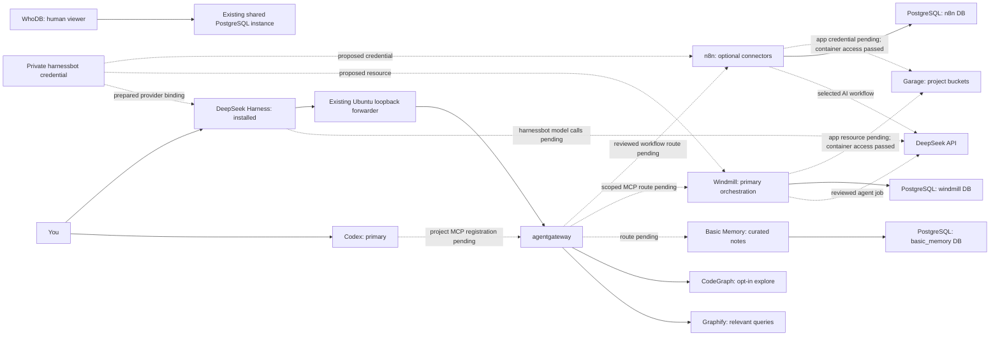
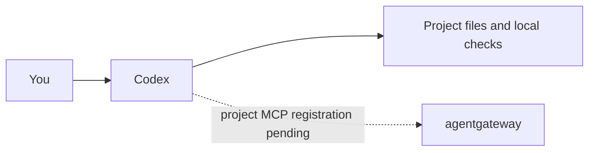
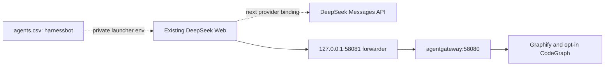
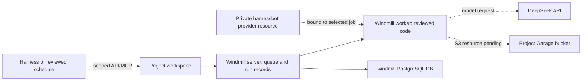
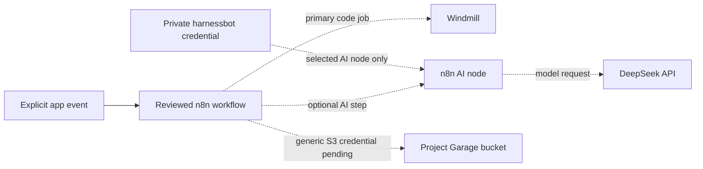
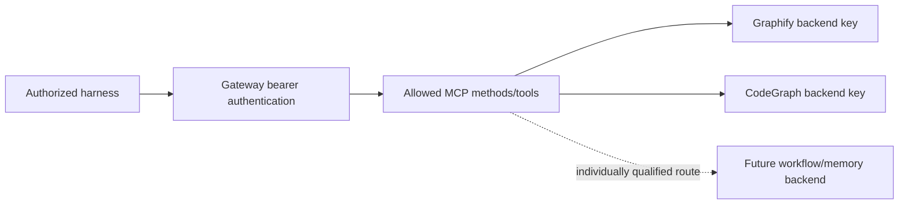
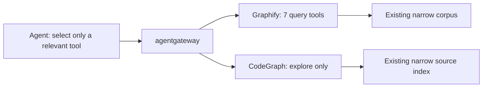
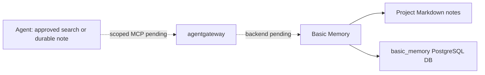
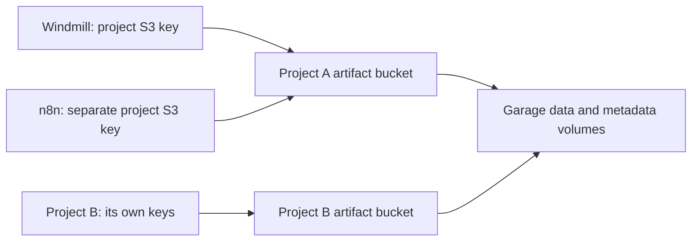
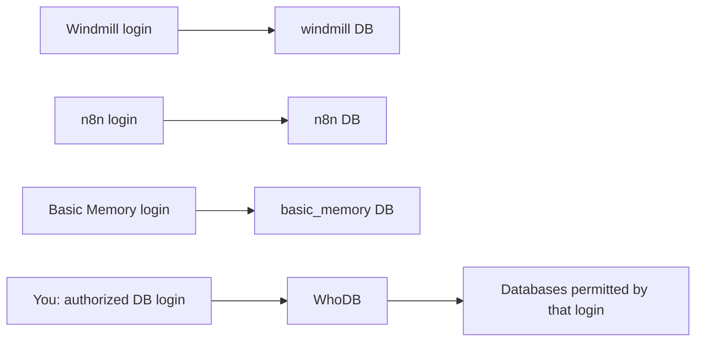

# Agent integrations and usage map

**Reconciled current status and diagrams: [canonical handover](HANDOVER.md).**
The detailed inventory below retains older proposals, including direct model-key
bindings and stale pending S3 labels. Those are not current activation instructions.
Use the handover's status tables and available/proposed flow diagrams at every stage.

2026-10-06: Anytype is sole PKM; Basic Memory secondary; ai-memory installed
candidate without hooks/model providers or gateway/harness bindings. Notion/AppFlowy
integration is excluded. Existing stack containers are stopped/preserved. The
hand-over's current diagram supersedes older per-tool inventory diagrams below.

Updated2026-10-05. This is the current integration inventory for the requested
DeepSeek `harnessbot` setup. Codex remains the primary interactive entry point;
DeepSeek is the selected model backend for the next agent bindings, with its
installed Harness available as a second interactive entry point.

**Latest refinement:** n8n's Garage credential is now registered; Windmill's
resource awaits an authenticated workspace token. To reduce provider-key spread,
the recommended next model design is one upstream key at the existing gateway,
with local caller tokens. Direct provider bindings below are historical proposals,
not activated configurations. See [message/data flow and key management](MESSAGE-AND-DATA-FLOW.md)
for the target sequence and exact current boundaries.

**Installed services are not automatically agent-connected.** Solid arrows below
describe installed/previously qualified paths; dashed arrows describe prepared
or proposed paths. Previous graph qualification is dated2026-10-03; no graph
query or agent model prompt was performed during this Garage install.

## Overall connections



The private alias selects one shared DeepSeek API key, not a common password for
the stack. Gateway bearer keys, PostgreSQL logins, Windmill/n8n access tokens and
Garage S3 keys remain separate credentials. DeepSeek does not receive those
secrets merely because it generates tool calls; the caller resolves them locally.

## Inventory and setup order

The machine-readable companion is [infra/agents/integrations.json](../infra/agents/integrations.json).
It contains references and status labels, never key values. It is guidance and
an inventory, not a running universal configuration loader.

| Tool | What the agent uses it for | Current integration | DeepSeek key needed? | Next binding |
| --- | --- | --- | --- | --- |
| Codex | Interactive planning, editing, review | Existing harness; stack MCP unregistered | No change to Codex provider | Separately scoped project MCP registration |
| DeepSeek Harness | Optional interactive agent | Existing Graphify/CodeGraph MCP qualified | `harnessbot`, prepared | Approved idle Web relaunch with project provider patch |
| Windmill | Reviewed repeatable scripts, flows, agent orchestration | Server/worker healthy; app bindings pending | `harnessbot` for model-calling scripts/agents only | Project workspace, private provider/S3 resources, scoped MCP token |
| n8n | App triggers, connector operations, optional AI node | Healthy; app bindings pending | Same alias for selected AI nodes only | Private DeepSeek/S3 credentials and one reviewed workflow |
| agentgateway | Authentication and allowed MCP calls | Two graph routes live | No, current gateway has no model route | Add each new backend after direct qualification |
| Graphify | Relevant relationships in approved corpus | Seven query tools exposed | No key for existing queries | Keep existing index and scope |
| CodeGraph | Explicit source-structure need | One explore tool exposed | No key for existing queries | Opt-in; no new indexing |
| Basic Memory | Curated notes/search | Service + PG/text search; agent route pending | No; semantic search stays off | Project binding and bounded MCP tools |
| Garage | Shared project files/artifacts | Healthy; both client-container acceptance passed | No; independent S3 keys | Register private app resources/credentials |
| PostgreSQL | Structured project/service data | Existing separate service databases | No; DB roles control access | Dedicated business DB only if needed |
| WhoDB | Human database inspection | Installed, healthy | No; AI features unnecessary here | Private scoped DB connection through UI |

OpenCode/OpenWiki stay optional; Notion/AppFlowy remain deferred. MetaMCP is
superseded; Activepieces remains retired. No excluded service is reinstalled.

## Per-tool diagrams

### Codex



Start simple work with ordinary file inspection. This request does not replace
the desktop's model/provider or create global MCP configuration. New-project
intent lives in that project's `.mstack/stack.json`; generated records are in
`.mstack/state.json`. The former example registries are retired.

### DeepSeek Harness



Installed official version0.2.0-rc.2 and existing Node24.19.0 are reused.
The prepared [project provider patch](../infra/harnesses/deepseek/harnessbot.cordis.yml)
selects the dedicated environment reference `MCP_STACK_HARNESSBOT_DEEPSEEK_KEY`
and limits the provider default output to4096tokens. Existing managed keys,
settings, sessions, graph overlay and vision-disable selection are preserved.
The native Messages endpoint is `https://api.deepseek.com/anthropic`.

The [launcher](../integrations/agents/deepseek_launch.py) default mode is a read-only
preflight. `--launch` is the proposed lifecycle step, not yet executed; it reads
only the matching CSV row, passes the key in the child's clean environment and
refuses a second Web listener. It never stops the current Web automatically.
Native Web trajectories show agent tool calls. Provider responses supply token
usage; a future usage export must preserve caller/project attribution.

### Windmill



Windmill is the main orchestration/code engine, version1.823.1. Create a private
provider resource for the chosen project. Prefer an explicit HTTP/SDK script
resource first: current online AI-agent conveniences may differ from this
pinned version. No paid cache/log features, worker-global provider environment,
new runtime dependency or global credentials are needed for a standard-library
HTTP call. Use `deepseek-flash` unless a job deliberately selects Pro.

Workspace MCP is a separate integration: scope its token to the project and
reviewed runnable(s), use bearer headers rather than tokens in URLs, verify the
pinned endpoint/tool list and qualify directly before adding a gateway route.
Do not expose arbitrary workspace execution as a default tool set.

Run history/logs track jobs, retries and results. Capture returned model token
usage with that job's ID. A retry may incur another model charge. Current workers
run trusted code; per-job hostile-code isolation is not configured.

### n8n



Use existing n8n2.41.6 for connectors. Its native DeepSeek credential needs the
`harnessbot` key; the model selector must accept the live IDs `deepseek-flash`
or `deepseek-v4-pro`. If the pinned node has a stale model list, qualify its
supported custom model/compatible endpoint rather than upgrading n8n automatically.
Keep credentials in n8n's encrypted store, not workflow JSON or global env.

An agent-facing workflow uses a reviewed MCP Server Trigger or the installed
instance MCP feature after permission/eligibility review. Workflow exposure is
different from letting an agent author arbitrary workflows. Prefer one bounded
connector workflow and no active trigger/schedule until deliberately enabled.
n8n Assistant, privileged Assistant sandbox and external Code runner are absent.
Use Windmill for reviewed Python work.

Track n8n execution IDs, Windmill job IDs and model usage separately. Workflows
that merely call Windmill need no DeepSeek key in n8n.

### agentgateway



Current v1.5.0 gateway routes are `/mcp/graphify` and `/mcp/codegraph` only.
It is not presently an LLM proxy or model-billing dashboard. Keep its client and
backend keys separate from `harnessbot`. Routes/authentication are enforced;
the project policy file alone does not filter sessions or create access isolation.
Gateway MCP calls are tool operations, not automatically DeepSeek model calls.

### Graphify and CodeGraph



The query servers use existing indexes, without a DeepSeek API call for each
query. Future Graphify extraction/indexing that uses an LLM is a separate model
integration and approved corpus operation. Do not mount the secret CSV into
either graph container or broaden existing indexes automatically.
CodeGraph remains opt-in and its existence does not mean every project is indexed.

### Basic Memory



No DeepSeek key is needed for the current text-search/document storage mode.
Bind an actual project and qualify search/read before introducing explicitly
approved note writes. No automatic conversation capture, secret ingestion,
semantic embeddings, model download or Notion/AppFlowy sync.

### Garage



Garagev2.3.0 is installed, healthy and container-tested. Cross-project bucket
access was rejected403 in acceptance. The durable demo bucket is
`project-mcp-stack-demo-artifacts`. Windmill/n8n each have a separate read/write
key, with no bucket-owner grant. Application resource/credential creation is
pending; the exact private fields are prepared under `infra/garage/state/`.
See [Garage setup](GARAGE-SETUP.md) and [installation evidence](GARAGE-INSTALL-RECORD.md).
S3 keys are not DeepSeek keys; no model provider gets raw object-store credentials.

### PostgreSQL and WhoDB



Preserve separate service application databases. Share project business data
through a dedicated project DB only when needed; never let tools write each
other's internal tables. WhoDB remains a human viewer; enabling its AI provider
would send selected database context to DeepSeek, so it is unnecessary for this
agent workflow and remains off. SQL access always uses a separate DB login.

## Usage tracking with one model key

Sharing `harnessbot` is enough for the first binding. DeepSeek's account billing
aggregates requests with the same key; separate keys later will improve provider-side
attribution. Caller-level tracking must meanwhile come from the harness, Windmill
and n8n records. No unified telemetry collector or dashboard has been installed.

For each model call, record: time, project ID, correlation/run ID, caller,
operation, provider/model, credential alias, provider request ID, input/output
and cached token counts if returned, elapsed time and status. Do not log the key,
HTTP authorization, prompts/responses, DB passwords or signed object URLs.
Record unavailable token fields as unknown, never as zero or estimated truth.
Record tool calls and retries separately; provider-side billed cost and local
token totals are different measures.

Example receipt (illustrative, not an executed request):

```json
{"project_id":"mcp-stack-demo","run_id":"example-only","caller":"windmill",
 "operation":"summarize_artifact","provider":"deepseek","model":"deepseek-flash",
 "credential_alias":"harnessbot","input_tokens":null,"output_tokens":null,
 "status":"not-run"}
```

Do not route every tool through a new LLM proxy just to draw a usage map. Keep
native logs first; add a minimal project usage table/export only after the first
model binding is working and a reporting need is concrete.

## Next concrete step: DeepSeek Harness provider activation

Target: existing Ubuntu Web on127.0.0.1:3080; existing CLI0.2.0-rc.2/Node24.19.0.
No package install, Docker action, global config write or key-store migration.
Use the existing graph URLs/keys and forwarder. The only added patch is
`infra/harnesses/deepseek/harnessbot.cordis.yml`; credential comes from the selected
CSV row into `MCP_STACK_HARNESSBOT_DEEPSEEK_KEY` in the new process environment.

Exact proposed launcher after separately confirming this lifecycle step:

```sh
python3 -B integrations/agents/deepseek_launch.py --launch
```

Before launch, verify current Web PID/start/executable/cwd identity and its native
session list is idle, then gracefully stop only that owned Web. Do not kill by
port/name, restart the forwarder, activate vision or interrupt a live agent job.
If not idle, wait or ask the owner. Keep retained sessions/settings/credentials.
Launch log is private0600 under `infra/harnesses/deepseek/state/harnessbot-web.log`
inside0700 state. It may contain a temporary Web login token; never publish it.

Acceptance: pinned native parse/schema checks pass; authenticated Web is available;
provider references the dedicated alias environment; graph entries stay active;
vision stays disabled; no unexpected profile package installation or unchanged
service restart. Merely opening Web does not prove the provider can infer.
An initial tiny synthetic model request, with no business data or tool execution,
is included in the next proposed activation scope: one direct Messages request to
the official endpoint, model `deepseek-flash`, input `Reply only OK.`, thinking
disabled, max64 output tokens, no tools and no retries. Record HTTP success and
returned token usage; keep the response free of real project content. This checks
the provider endpoint/key, not an end-to-end autonomous agent workflow. No such
request has been made; current key verification was only `GET /models` returning200.

Offline qualification passed: installed native provider/default-model schemas,
base+Web+project patch composition with no warnings, launcher preflight,
JSON/TOML/Python syntax checks and Garage Compose validation. The validator was
corrected to read native volatile fields with `.get()` and the default model
class's static `Config`; no vendor package/configuration was changed.

Rollback: stop only the newly owned idle Web process; relaunch the previous
qualified command without the provider patch or dedicated key environment,
preserving current home/session files. No restore of stale backups or key rotation.
This changes the running Web and is distinct from the now-completed Garage install.

Windmill/n8n bindings follow one tool at a time, using project-scoped access tokens
obtained through the owner's authenticated UI. Do not ask for owner passwords or
read/browser-copy cookies. Workspace/project choice must be settled before creating
those persistent app bindings. This plan provisions neither a workflow nor tokens.

## References

- [DeepSeek API endpoints/current models](https://api-docs.deepseek.com/)
- [Official Harness model/credential guide](https://github.com/deepseek-ai/deepseek-harness/blob/master/docs/user/guide/providers.md)
- [Windmill MCP](https://www.windmill.dev/docs/core_concepts/mcp)
- [Windmill agents](https://www.windmill.dev/docs/core_concepts/ai_agents)
- [n8n DeepSeek credentials](https://docs.n8n.io/integrations/builtin/credentials/deepseek/)
- [n8n MCP](https://docs.n8n.io/advanced-ai/accessing-n8n-mcp-server/)
- [Current native graph registration evidence](DEEPSEEK-LOOPBACK-MCP-ACTIVATION-PROPOSAL.md)
