# mstack handover

## 2026-10-21 — OpenCodex removed after Magpie migration

The user then explicitly requested removing OpenCodex. Its stopped container,
two dedicated volumes, unused image, credentials, setup files, old Claude profile
and dedicated backup copies are deleted. No OpenCodex rollback remains. Older
retention instructions below are historical and superseded.

All 31 other containers present at removal, unrelated volumes and networks stayed
unchanged. Claude's Magpie route, DeepSeek credential and Mac/Ubuntu Codex config/auth
are preserved. Magpie's catalog and management login still pass without inference.
Codex integration remains pending; obsolete project routes cannot launch or inherit
Magpie. Use `magpie_manage.py` for the documented local operations. See the
[removal record](../infra/maintenance/opencodex-retirement/README.md) and checks.

## 2026-10-21 — Claude Desktop uses Magpie; Codex pending

The user chose Magpie for management, migrating Claude first. The installed
Claude Desktop 3.1623.0 now points to installed Magpie 0.1.1206 on Mac loopback
3425, with the existing official DeepSeek Flash provider. Its authenticated web
management endpoint is loopback 3430. It is running as a background process,
without login autostart. Account discovery/refresh and automatic updates are off.
Mac/Ubuntu Codex config and auth are unchanged; integration awaits explicit request.

Streaming and automatic tool/result handling passed in three synthetic requests.
The management login and native profile readback passed. No foreground window was
opened, so the actual Desktop UI, Code/Cowork and project MCP remain untested on
this route. All 33 containers are unchanged; OpenCodex remains stopped and retained
for rollback. The only running container at this check was unrelated
`yel453-stage8-postgres`. This supersedes older service uptime statements below.

The broken old Claude profile symlink was replaced with a native generated
library, preserving all three files by hash, because Magpie's atomic metadata
writer fails across the OrbStack mount. Repository runtime intent/private Magpie
state stay under `infra/`; the old OpenCodex profile remains intact. A failed
launchd attempt was removed. Use the [Magpie guide](../infra/magpie/README.md) for
the evidence-based comparison, normal startup, limits and scoped rollback.

## 2026-10-19 — repository relocation completed

The canonical checkout is `/home/developer/workspace/mstack`; the old sibling
alias is removed. All nine user chats retain their original histories and archived
status under the single mstack desktop project. DeepSeek/Serena references and
operational host paths are repaired. Six affected containers were recreated with
new bind paths while staying stopped; all persistent data is retained and the
other 24 containers are unchanged. No approval or cleanup remains pending.
See the [relocation record](../infra/maintenance/repo-relocation/README.md).
Older host paths below are historical. Native desktop work is complete.

## 2026-10-16 — root .mstack folder and example cleanup (latest)

Use [MSTACK-CONFIG.md](MSTACK-CONFIG.md): one editable `.mstack/stack.json` and
one generated `.mstack/state.json`. Project credentials, optional schemas,
evidence and helper cache share `.mstack/`; its `.gitignore` protects generated
and private files. New projects need no infra directory. Shared infrastructure
and existing service credentials keep their current paths. Legacy readers and
separate configs are retired.

Local example projects, shared tenants and A/B gateway routes/keys are removed.
The example Anytype channel is deleted and its key returns 401. With explicit
approval for the initial Windmill admin login, its example workspace and two
tokens were deleted; other workspace IDs are unchanged. Follow-up confirmed
absence and session revocation (401). Temporary credential copies are removed.
No example cleanup or permission request remains pending.

83 Python tests pass for the current layout; five Node adapter tests passed in
the preceding retirement step. All containers and unrelated data are preserved.
See the [cleanup record](../infra/maintenance/config-retirement/README.md).
The native UI quiet window ended. Older example setup/proof instructions and
config locations below are historical and must not be replayed.


## Minimum defaults and Docker namespace — 2026-10-16

The user made the current shared routing the minimum default and requested the
Docker namespace rename. `infra/stack.json` now needs only a stable `project` ID;
omitted version/preset resolve to v3/daily. Daily selects Codex, shared Headroom,
Graphify, scoped Anytype and Windmill, with the existing gstack browser available.
Selection is not a mandatory tool sequence or provisioning. New projects still
need their own qualified tenants/grants. CodeGraph stays ignored; no memory mirror,
schedule, provider call or global harness configuration change follows.

Docker Compose project is now `mstack`, superseding older namespace instructions.
The 11 existing services were recreated with the same pinned images, credentials,
ports, persistent mounts and resource settings: nine running, ai-memory and
agentgateway stopped. All 19 unrelated containers are unchanged. Stable container,
volume and network names retain `mcp-stack` where needed for compatibility; the
repository path and project identities are unchanged. Explicit external volumes
and networks prevent replacement data allocation. PostgreSQL's obsolete reference
to the removed mail-only network was repaired through its current definition;
do not restore that network or reuse the original stale container definition.

Use `docs/MSTACK-CONFIG.md` for diagrams and `docs/MSTACK-NAMESPACE.md` for migration
evidence. The external example now has a one-field intent and its existing grants.
The infrastructure root uses explicit `solo` because it has no Anytype grant.
Use `mstack run` for direct Codex bindings; `apply` remains gateway reconciliation.
No project-wide down/remove-orphans. Historical migration helpers are not health
checks or startup commands. Only relevant work should trigger actual tool calls.


## Shared Headroom and WhoDB resumed — 2026-10-16

The user requested shared Headroom and starting WhoDB. `mstack-headroom` now
runs pinned Headroom 0.34.0 / MCP 1.29.0 with separate authenticated tenant
SQLite caches/statistics. The external example selects its shared binding;
existing global helpers/configuration remain unchanged. Native compression,
concurrent tenant isolation, foreign-hash rejection, reconnect and exact
retrieval after shared stop/start pass. Originals expire after one hour.
No network, model/provider calls, file-read tool or automatic traffic proxy.
Four example Anytype documents are saved/read-back verified, including the new
Headroom note. Other projects must register their own tenants explicitly.

WhoDB is healthy at Mac localhost:58091 after starting its original container,
preserving its volume and encryption settings. No DB connection was added.
All 28 other pre-existing containers stayed unchanged; only Headroom was added.
ai-memory and agentgateway are optional for the current direct-MCP workflow;
leave their existing state alone. CodeGraph remains ignored. See
`infra/headroom/README.md`, `infra/whodb/resume-20261016.json` and
`docs/HARNESS-CONNECTIONS.md`. Shared service stop affects all its tenants.

## Shared services and project tenants — 2026-10-16

The user requires one reusable container per tool, with project tenants inside
it, rather than `example-[tool]` containers. `mstack-graphify` and
`mstack-anytype-mcp` now serve authenticated project sessions. The external
mstack-example project is migrated; its old two containers are removed. The
Graphify index was copied byte-for-byte without reindexing. Anytype retains its
own channel/key; three documents have verified read-back. Two temporary Graphify
tenants passed concurrent isolation checks in the same running container and
were removed. Shared stop/start preserves tenant state. All 27 unrelated
containers retain IDs, start times, images and mounts.

Use `infra/services/README.md`, `infra/services/compose.yaml` and the tenant
commands. Project `infra/stack.tenants.json` selects its own private credential;
never reuse another project's grant or create a container per project. A tenant
registration is not automatic indexing or a qualified harness binding. Shared
service stop affects all tenants. The Docker owner/admin remains trusted; this
is an authenticated MCP boundary, not hostile-public-tenant isolation. Windmill
keeps its existing workspaces; Garage keeps explicit bucket/key grants. No new
S3 binding exists. Headroom/Serena/gstack and protected system tools remain.

Ignore CodeGraph for now: do not restore, install, index or convert it. This
supersedes previous per-project container guidance. No provider/model call,
automatic memory mirror, schedule or global harness configuration change ran.
The six-stage proof includes fresh shared-service/configuration checks and
explicitly carried-forward evidence for unchanged gstack/Headroom/Windmill.

## Live service correction and Garage resume — 2026-10-16

The user reported missing graph services and stopped Garage. Live inspection
confirms `mstack-example-graphify` is running; its native MCP answers with 17 nodes
and 23 edges. CodeGraph's old container and exact image are absent; its config,
source and limited index remain. It was not restored in the example exercise.
The six-stage proof covers the selected example workflow, not all retained tools.
The Anytype Node container is a stdio MCP adapter to the desktop API, with no
published HTTP port or separate Anytype data store.

Resumed only existing `mcp-stack-garage`, preserving its ID, image and volume
mounts. It is healthy; both retained service keys pass read-only S3 listing from
the Windmill worker, anonymous requests return 403, and all 28 other container
snapshots match. No new bucket/key/object, app binding or storage migration.
The external example does not yet use S3 for its reports. Evidence:
`infra/garage/resume-20261016.json`. The prior clean stop was October 11 at
21:14 UTC; its actor/cause is unknown.

## External project qualification and foreground pause — 2026-10-16

The user replaced the in-repository demo with `/home/developer/workspace/mstack-example`.
Use `docs/MSTACK.md` and its own project instructions. Actual harness capabilities
come first; missing selected capabilities need dedicated containerized backends.
A Graphify skill does not substitute for the engine. Graphify 0.9.72 now runs in
`mstack-example-graphify`, indexing only the example's two Python files, without
network/model calls. Existing Headroom/Serena/gstack are retained. Windmill's two
existing containers were resumed; its isolated example workspace/report and
restricted API/MCP tokens are qualified. Other services/data are preserved.

Use background APIs, containers and isolated headless browsers while the user
uses the Mac. Native app control requires an explicitly arranged quiet window.
The user offered that window on October 16 and authorized completing Anytype.
The new mstack-example personal channel and its read/write-only channel grant
are qualified through the dedicated Anytype MCP 2.0.1 container. All-spaces access
is off; an out-of-channel request returns space_not_granted. The brief and verified
result were saved and their contents read back. Ordinary document work now uses
background MCP/API. The old demo key is revoked (401), channel deleted and local
directory removed. No grant was borrowed. All six saved proof stages pass against
the completed external-project configuration. No automatic mirror or schedule.

Native Codex discovers the external AGENTS.md and mstack skill. Project MCP files
still require normal project trust. The explicit `mstack run` invocation is
verified without global settings/auth changes. Claude Code files are prepared,
not a qualified Claude session. No inference/provider call ran. Direct `plan`
does not consult unrelated gateway projects. `doctor` checks enabled bindings;
`proof` checks all six saved proof receipts, including the completed Anytype stage.

See [MSTACK.md](MSTACK.md), [the example README](/home/developer/workspace/mstack-example/README.md), and [infrastructure evidence](../infra/projects/mstack-example/README.md).

## Retain infrastructure; keep the daily workflow small — 2026-10-16

The user explicitly retains harnesses, Anytype, Windmill, OpenCodex and its setup,
Llama.app, PostgreSQL + pgvector, WhoDB, and Garage. OrbStack and mise must not be
removed. The recommendation is to reuse existing Headroom/Serena/gstack helpers
selectively. Graphify's skill interface and CodeGraph's CLI can support on-demand
project work, but both still need engines/indexes; no conversion was performed.
DeepSeek's provider connection in OpenCodex is distinct from DeepSeek Harness.

Updated the fresh-project prompt, its inventory, the entry guide, and agent
instructions. Removed stale mail connection summaries from the prompt/inventory
and corrected its retained dependency list after the completed mail retirement.
No runtime/service, credential, global registration, backend, or model changed;
no live service/provider qualification was run. Existing non-mail components
remain preserved, used when a real task requires them.

## AI mail setup removed — 2026-10-15

The user explicitly cancelled all AI mail integration and requested removal of
Inbox Zero, TimeCyber/email-mcp, both Microsoft Entra apps, and both Google links.
This supersedes every earlier mail preservation, onboarding and continuation
instruction below. **Do not reinstall, reconnect, regenerate credentials, or
resume the Hotmail/Outlook/QQ setup.** Actual mailboxes/messages are untouched.

Both Entra registrations were deleted and are absent from the refreshed active
app list. Google confirmed Inbox Zero OAuth revocation (HTTP 200); the named
TimeCyber Google app password was revoked and is absent. Inbox Zero's dedicated
DB/role, three containers, Redis volume, two networks and unused image references
were removed. Both local runtimes, source clones, launch/configuration files,
credentials, caches and app-specific backups were deleted. Historical broad
container snapshots had only their mail-container environment values scrubbed.
The exact Inbox Zero Google OAuth client was also deleted; the active client
list is empty. All six requested mail cleanup items are complete.

Shared PostgreSQL, its other databases, OpenCodex/DeepSeek, {{mstack:CLIENT_REPO_CAMEL}} and all 27
unrelated containers are preserved. The mail-only PG network was detached;
`infra/postgres/compose.yaml` now directly preserves the existing external volume
and prior platform/pull settings, so the deleted mail overlay is not required.
The pre-mail shared PG recovery copy moved to `infra/postgres/.state/recovery-20261009`.
See `infra/maintenance/mail-retirement/README.md` and its evidence. The user also
requested removing stored mailboxes: the mail database/account files are absent,
and historical account connection summaries were removed from these project notes.
Do not retain mailbox identities or reconstruct their account profiles.


**Everyday work starts in [START-HERE.md](START-HERE.md).** Consult and update
this handover for relevant stack maintenance and integration evidence.
Last project update: **2026-10-16, Asia/Shanghai**.
Prior acceptance evidence remains dated; all 30 Docker container identities and
start times were rechecked unchanged on October 15 during the Linux mise cutover.

## Everyday workflow simplified — 2026-10-15

The follow-up request condensed the restart context into one
[copyable fresh-project prompt](FRESH-PROJECT-PROMPT.md), with a separate reference
inventory in that same document. Only the prompt is intended for a new chat;
old integration history is consulted when a concrete requirement needs it.
No new project/chat, connection, service, or runtime change was created by this
documentation task. The inventory reports recorded state, not a fresh uptime audit.

The user selected Codex + Claude, Anytype, and Windmill as the small everyday
workflow and wants to stop expanding the stack before doing real work. The
entry guide now describes a task-first session, one curated personal-context
note, and automation only when a proven task benefits from repeat execution.
Explicitly supplying the personal note is sufficient; automatic cross-project
memory is not claimed or a prerequisite.

Agentgateway, graph retrieval, extra memory services and unfinished onboarding
are outside the everyday checklist. Older derived ai-memory refresh instructions
are superseded for this workflow. Historical checkpoints remain available for
explicit continuation; they are not an automatic integration backlog.

Only `AGENTS.md`, `docs/START-HERE.md`, and this introduction changed. No runtime
configuration, service, credential, harness registration, Anytype object or
Windmill job was changed or tested. Root Anytype remains unbound; the recorded
Claude Desktop inference acceptance does not qualify tools, and Windmill native
project-job acceptance remains pending. Manual document use allows work now.

## Mise helper drain — completed 2026-10-15

The user authorized temporarily stopping the remaining fnm/uv consumers to
finish migration. **16 verified helper trees / 44 processes stopped cleanly**;
the main Codex daemon stayed running. Existing MCP bindings reconnected through
Codex's runtime reload API. **Headroom and Serena are connected in all 10 loaded
sessions**, with their Python, Node and language-server processes using mise.
There are **zero remaining processes using the legacy runtimes**.

Rebound **146 existing Python environments** to mise Python 3.13.15 by changing
only interpreter links and `pyvenv.cfg` home fields. Preserved 21,931 package
identity records; every environment passed offline execution/base-prefix and
native stdlib checks. No package reinstallation or dependency upgrade occurred.
Keep uv's application environments and cache: mise now owns their interpreter
and uv executable; those directories still hold the applications/dependencies.

Relocated the exact DeepSeek profile dependency tree into ignored project
`infra/harnesses/deepseek/runtime/profile-packages/dsh` and retargeted **430
links**. All 25,906 package files and 3,711 profile real files are preserved;
96 pre-existing broken links are unchanged. This avoids the dependency version
drift in the fresh mise package tree. Both trees pass offline native composition
with fnm absent. Retained-profile startup/model/tool execution remains untested;
no DeepSeek Web/forwarder was started.

The original fnm store and old uv Python directory/alias are **absent from home**,
retired to private rollback quarantine after complete archive comparisons.
Application data, settings, credentials and caches remain intact. All **30
containers** retain their names, IDs and start times. Native Codex configuration
and authentication files are unchanged. No model/provider/mailbox call ran.
**64 migration tests pass.**

The 25 reconnected Headroom/Serena/Pyright consumers also match their original
package/source identities; Serena retains commit
`4f2520efb128dd02e66a2302095bdbbb26ddd5a0`.

The completed execution path is:

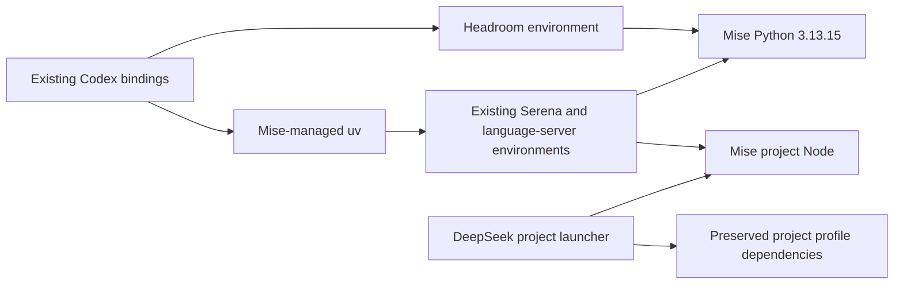

Full current status and rollback: [migration record](ORB-DEVBOX-MISE-MIGRATION-2026-10-15.md).
Latest public evidence: `infra/maintenance/orb-devbox-mise/qualification-2026-10-15-drain.json`.
The first cutover below is historical where it says legacy stores must remain.

## Initial Ubuntu mise cutover — earlier on 2026-10-15

The approved OrbStack Ubuntu migration is active. Reused **mise 2026.9.6**;
installed and verified **20 unique same-version tools**. Project declarations
and locks live under `infra/`, with root `.mise.toml` linking to `infra/mise.toml`.
The repo-owned shell bootstrap and 25 compatibility commands select installed
tools and refuse missing versions. No global Node/Python selection was added.

New shells use root Node **24.19.0**, npm **11.17.0**, Corepack **0.35.0**, pnpm
**10.33.0**, Bun **1.3.14**, uv **0.12.3**, Git **2.54.0** and the pinned common
CLIs. {{mstack:CLIENT_REPO_CAMEL}} retains its existing Node **24.21.0**. uv's explicit invocation
profile selects mise Python **3.13.15** for new environments; OS Python and
existing application interpreters remain intact. Existing terminal/editor/MCP
processes retain their environment; open a fresh terminal for the new setup.

Exactly **12 duplicate apt CLI packages** and the unused standalone Bun
binary/link/completion were retired. Exact cached rollback `.deb` files and
the verified legacy archive remain private. **Keep the fnm store** for active
language servers and DeepSeek's unchanged profile dependency links; the latter
remain needed after process exit. Keep uv Python/tools/cache for running MCPs.
No process was forcibly restarted, and no cache/worktree/app-data cleanup ran.

Email MCP's launcher now selects mise Node 24.19.0; all three synthetic checks
pass without real accounts. DeepSeek's preparation launcher and native offline
composition pass on the new package layout; existing profile links/settings are
preserved. No Web/forwarder start, provider/model call or real mailbox operation
was performed. This qualifies toolchain resolution, not retained-profile startup.

Verification: **45 migration unit tests**, all 20 replacement checks after
cleanup, 12 offline Git/LFS/worktree steps, root/{{mstack:CLIENT_REPO_CAMEL}} precedence, actual cwd/
literal arguments, all 25 command paths, and Bun loading existing gstack pass.
All **30 containers** have identical names, IDs and start times. Protected Bash,
profile and user-global mise config match the snapshot; OS Python/PG are
unchanged. Native macOS tools, Codex authentication/settings, gateway/provider
configuration and databases were not changed. npm pins are verified, but their
transitive artifacts are not fully covered by mise.lock.

The message/execution path is now:

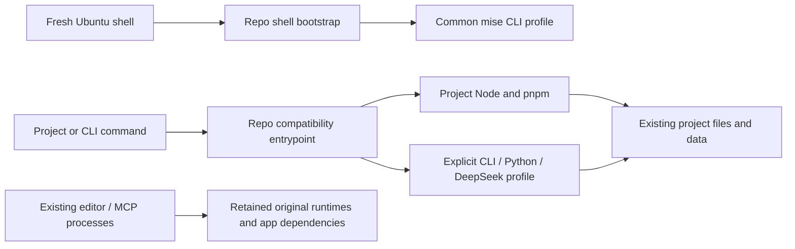

Mise selects executables; it does not route model/MCP messages or move application
data. The existing harness ↔ tool/gateway and application data flows below remain
unchanged. Full versions, operating/rollback instructions and private evidence
pointer: [migration record](ORB-DEVBOX-MISE-MIGRATION-2026-10-15.md).
Public evidence: `infra/maintenance/orb-devbox-mise/qualification-2026-10-15.json`.

## Shared DeepSeek compatibility setting — 2026-10-13

The existing OpenCodex DeepSeek provider retains its shared
`noJsonSchemaModels=["deepseek-flash"]` compatibility setting. It converts
unsupported JSON-schema response requests to JSON object mode; callers must
validate responses locally and describe the desired shape in their prompts.
The proxy is used by other clients and remains installed with its existing keys.
The retired mail application and its connection/account records are removed.

## Magpie removal — 2026-10-12

macOS `/Applications/magpie.app` 0.1.1206 (`com.yetone.magpie`) was moved to the
owner's Trash at their request. No agent configuration was changed. Restore only
if explicitly requested. The later mail applications and stored mailbox records
were removed on 2026-10-15; no onboarding remains active.

## Service recovery — 2026-10-09

**Restored and verified:** WhoDB at Mac `http://127.0.0.1:58091/`, Windmill at
`http://127.0.0.1:58090/`, Garage S3 at `http://127.0.0.1:53900`. Their four
containers/images were absent while original data and credentials remained.
Verified offline-volume and Windmill database backups preceded recovery. Same
versions/data, healthy UIs, one worker heartbeat, 673 Windmill migrations and
original Garage node/bucket/client keys are qualified. Windmill uses its original
ARM64 manifest directly after registry/index-provenance download failures; all
37 executable layers were checksum verified and match the original filesystem
chain. All 19 pre-recovery containers were preserved. The deletion cause/time/
actor cannot be established from retained logs. See
[the recovery report](SERVICE-RECOVERY-2026-10-09.md).

## Shared PostgreSQL recovery — 2026-10-09

The missing original PostgreSQL service was recovered from its retained
`mcp-stack-postgres-data` volume after an offline backup and clean-shutdown
inspection. Existing Basic Memory, n8n and Windmill schemas/roles were preserved.
The subsequently added mail-only database, login and network were removed on
2026-10-15. The shared service remains running, with current configuration under
`infra/postgres/compose.yaml` and the pre-mail recovery copy under
`infra/postgres/.state/recovery-20261009`. Do not restore the removed mail setup.

## orb-devbox cleanup and Inbox Zero clarification — 2026-10-09

The user requested Linux Supabase CLI, Bun and Deno removal after the toolchain
audit. **Supabase CLI 2.117.0 and Deno 2.9.5 are removed**, including dedicated
residue and Deno shell hooks. The four {{mstack:CLIENT_REPO_CAMEL}} checkouts now restrict their
existing Supabase mise declaration to macOS, preventing Linux reselection.
All 15 existing Docker container identities were preserved. **Bun is retained
for now:** the user requested the gstack dependency explanation and conditional
retention if mise-managed. Inspection confirms Linux Bun 1.3.14 is standalone
at `~/.bun/bin/bun`, with no mise Bun install/shim/receipt. gstack uses its compiled
executables, SQLite, TypeScript and HTTP APIs; source helpers/scripts depend on
external Bun. The two helpers seen during the audit have since exited without
intervention by this task. Migration to mise remains proposed. No Bun or macOS
tool change has run.

iOS compression tests already live in
`/Users/{{mstack:MAC_USER}}/Developer/{{mstack:CLIENT_BRAND_LOWER}}-ios-media-lab`; the encoder matches the Linux
candidate exactly. Existing simulator/local-upload evidence is recorded there.
The Linux clone still holds a separate uncommitted app integration patch, so
preserve it before retirement. Preview large CN transport remains incomplete.

Inbox Zero's full Docker runtime includes Node. Host Node 24+ is only required
for its optional setup CLI/source installation. Keep future configuration in
the VM and use the existing macOS OrbStack engine; Docker remains system
infrastructure. Node 24.21.0 is already installed under mise on both machines.
This earlier cleanup did not start Inbox Zero; the later foundation above is now
installed. Provider connection and broad toolchain migration remain pending.
See the [cleanup record](ORB-DEVBOX-CLEANUP-2026-10-09.md),
[audit](ORB-DEVBOX-MISE-AUDIT-2026-10-09.md) and
[Inbox Zero plan](INBOX-ZERO-SETUP-PLAN.md).

## Notion document transfer to kase — 2026-10-09

The user explicitly requested a one-time Notion → Anytype transfer and creation
of the personal channel **kase**. Linguist, Thing Logs and Content Base share
this channel. **567 pages, 42 collections, 451 memberships and 121 available
attachment references** were transferred; all 609 migrated page/collection
objects were read back with zero unresolved transformation differences. The
desktop rendered checks covered the main entries and inline collections.
Original files/source structure are preserved in six verified archives inside
the channel. Formula values are snapshots; timeline views become calendars;
six opaque/empty source blocks retain original Notion links. See the
[migration report](NOTION-ANYTYPE-MIGRATION.md) for exact scope and limitations.

Later the same day, the user requested clearing the migration-created top-level
types and using the **Collections** panel. All 451 database rows were changed to
the built-in Page type, all 98 view defaults across 62 objects were updated, and
the exact 42 migration-created types were archived in Bin. The 42 native
collections remain under Collections, preserving IDs, properties, membership,
inline positions and links. Fresh backups and a read-back comparison of all 612
pages/collections found zero unexpected differences. No live migration-created
type or assigned row remains. Cleanup evidence and rollback definitions are in
the ignored `organization-cleanup/` state directory; the old migration scripts
must not be rerun to restore the earlier per-database type scheme.

This bounded migration uses the existing authenticated macOS `ntn` CLI for
source reads and a new **kase-only** Anytype grant through the existing macOS
loopback API. The explicit migration binding is
`infra/migrations/notion-to-anytype/config.json`; private credential/state
remain ignored. Notion was not edited. No ongoing Notion integration/sync,
service setup, global harness registration or Clock grant reuse follows.
Root Anytype remains unbound. Anytype saved; **memory refresh pending** because
the migration has no provisioned ai-memory binding.

## Unified project config and reconciliation — 2026-10-08

**Implemented:** project `infra/stack.json` v3 is now authoritative for tool choices,
purposes, access, account references and project scopes. Shared URLs/auth methods
and private credential references are in
[infra/stack/connections.json](../infra/stack/connections.json). Actual secrets
stay in ignored `.secrets/`; no credentials were moved into config. JSON Schema
validates both sources. Existing v2 configs remain supported.

**Normal entry:** `stack init` → edit project intent or ask the harness to do it →
`stack plan` → `stack apply` → `stack doctor` → work with `stack run` when ready.
This is explicit reconciliation, not an idle watcher. It does not install tools,
perform OAuth, create Anytype objects or download/call models.

```sh
./stack plan --project examples/project-a
./stack apply --project examples/project-a
./stack doctor --project examples/project-a
```

For a simple new project, `./stack init <directory> --preset project` writes its
small config, empty bindings and discoverable skill. Optional `tools.codegraph`
`enabled: false` disables it even if a preset/context selected it. Named connector
`connection`, `space`, `access`, `url`, `credential_file` and typed `input` determine
that project's intent. A project override leaves the shared account and other
projects unchanged. Blank inherited scopes remain disconnected. Changed endpoint,
credential reference/contents, scope or access invalidates old qualification.

**One strategy source:** `infra/agentgateway/projects.json` is now a generated
compatibility snapshot. Do not maintain project choices there separately.
`stack connections` derives its plans/renders from the new sources too. Managed
`infra/stack/project-index.json` registers directories; each project gets private,
Git-ignored `infra/stack.runtime.json` launch settings. Bindings remain separately
recorded evidence, not another strategy file. Direct tool overrides need matching
project evidence; named shared connectors currently use the gateway.

**Migration:** A/B input and selections now live in
[project-a config](../examples/project-a/infra/stack.json) and
[project-b config](../examples/project-b/infra/stack.json). They remain **examples
with blank real destinations**, not newly bound production projects. Root and
Clock use v3; root Anytype is still unbound and Clock preserves its qualified
direct adapter. Pre-migration gateway registry and root/Clock input copies are
preserved alongside existing infra. All four were applied; Clock passes local
preflight, while root and A/B correctly remain not ready.

**Apply behavior:** all registered project routes are resolved together; unrelated
projects and caller keys are preserved. Identical intent is a no-op, including
no generated-file rewrite or service restart. A changed gateway uses only the
existing pinned `mcp-stack` agentgateway service, with a private config backup,
targeted recreation, verification and rollback on failure. It creates no other
service and never removes orphans. Config/evidence/file mutations use a private
reconciliation lock. Provider scope remains enforced by qualified grants/adapters,
not names or file config alone.

**Owner UI:** remains fully editable. Default apply detects drift and stops rather
than silently overwriting it. Choose `stack adopt --project <directory>` for
logging and separate non-project listeners/routes, or review the plan then use
`stack apply --project <directory> --drift restore`. Managed project/auth changes
must be expressed in project intent and qualified; adoption does not guess provider
scopes from arbitrary native UI backends. No extra host port is published by adopt.

**Harness boundary:** project Codex invocation settings use secret environment
variables, preserve native login/global config and disable unselected inherited
MCP registrations only for that invocation. Claude gets a connection manifest;
apply does **not** register Claude Desktop connections. The present desktop chat's
provider/tool menu does not change. Model routes still use their existing separately
qualified setup; no DeepSeek/local-model inference or fallback was performed.

**Verification:** **31 tests passed** (21 stack, 10 gateway). They cover idempotence, per-project updates,
UI drift/adopt, secret-reference/URL rejection, credential rotation, YAML 1.2 parsing,
missing bindings and rollback. Native owner API config matches the active runtime.
Ubuntu gateway transport accepts its project key and the unbound route remains
503. Clock invocation inspection shows only `project_anytype`. Migration/repeated
apply required **zero container recreations**; caller keys and owner password,
all container IDs/start times and unrelated services are preserved. Live provider
and model calls: **zero**. [Qualification record](../infra/stack/qualification.json)
and [full config contract and recovery](../infra/stack/README.md).

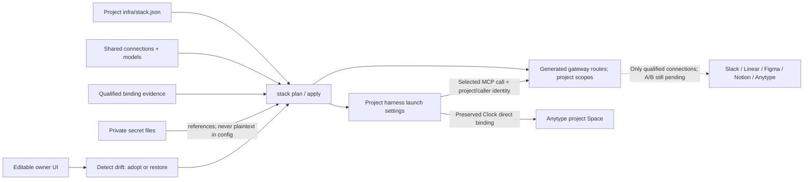

## Gateway web UI and documented config — 2026-10-08

**Owner UI:** open `http://127.0.0.1:58084/ui` directly in your Mac browser.
Username **owner**; the **existing password is unchanged**, in ignored
`.secrets/agentgateway/ui-password` (0600). It is separate from OpenCodex/admin
and project MCP keys. The user rejected our unrequested read-only setting;
**editing is enabled** and saves persist to the mounted runtime directory.

**Blank-page diagnosis:** the user observed Codex Command-click rewriting this
link to `http://localhost:62966/ui`. That forwarded address does not target the
native Mac listener. The exact address was opened through macOS `open`, bypassing
Codex forwarding. For subsequent visits, paste the address in the Mac address bar,
or from this Ubuntu workspace use:

```sh
macctl run open http://127.0.0.1:58084/ui
```

**Rendered page verified:** title `agentgateway`, heading `Gateway Overview`,
no read-only banner, and enabled `Set up gateways` control. The native UI edits
gateway configuration; it does not edit our project registry or automatically
perform provider OAuth. `MCP: Not enabled` and `LLM: Not enabled` reflect the
currently blank tool bindings and absence of a model route.

Same pinned v1.5.0 container, Compose namespace **mcp-stack**, Mac ports MCP
**58080** and UI **58084**. The owner login protects UI/API paths. Raw
admin/stats/readiness listeners stay off; direct debug/shutdown paths are not
published. File storage mode permits owner configuration writes. No database,
new image/package or unrelated service was added.

**Persistence and source of truth:** UI saves the active file
`infra/agentgateway/state/projects/runtime/config.yaml` through a writable
**directory** mount. The non-root container has supplementary group 501; only
this directory is writable (directory 0770, active file 0660). The root filesystem
remains read-only. Existing caller keys and the private browser password are
preserved. The bcrypt hash is referenced by file, avoiding `$2b` interpolation.

Project `stack.json` and shared `connections.json` describe intent;
`projects.bindings.json` records accepted scope evidence. The generated snapshot is
a compatibility view, superseded as an input source by the unified section above. `connections render` generates a candidate `state/projects/config.json`
**without overwriting existing owner UI edits**. To deliberately replace the
active runtime from that candidate, use `connections apply`; it first keeps a
private hash-named backup of the previous runtime. UI-only edits are not copied
back into project intent. Review that difference before choosing either route.

**Detailed inputs (compiled view):** [projects.json](../infra/agentgateway/projects.json) includes
project repo/display name/goal, harness selection, tool purpose, enable switch,
read/write mode, OAuth credential references/desired permissions and typed resource
scopes. Existing A/B identities and caller keys were preserved. Shared accounts
can still be reused, while each project can override scope. All destination/auth
values remain blank for one-at-a-time setup. Separate Anytype Spaces are required;
duplicate enabled Space IDs are rejected. These fields do not register harness tools.

**Typed config is implemented with JSON Schema 2020-12**, used by the editor and
CLI. Three documented local schemas under
[integrations/gateway/schemas](../integrations/gateway/schemas/projects.schema.json)
cover intent, live binding evidence and owner UI settings. The `$schema` links give
schema-aware editors field descriptions/suggestions. The CLI validates types,
unknown keys, wildcard scopes, private credential path boundaries and project/tool
references before plan/render. Invalid input values are not echoed in errors.

```sh
./stack connections validate
./stack connections plan --project project-a
```

Validation is local and has no OAuth, model/tool calls or key generation. Blank
config can be valid while its connections remain unready. Read/write changes need
matching qualified binding evidence; disabling a tool blocks it regardless of
existing evidence. JSON is supported now; YAML loading, Pydantic objects and CUE
are optional future choices, not additional installs. Recommendation: keep the
single JSON Schema contract until a larger Python application warrants typed
objects. [Detailed inputs and tool comparison](../infra/agentgateway/projects/README.md).

**Checked:** missing/wrong owner login 401; HTML and two JS/CSS assets 200;
runtime/effective-config/resources APIs 200; owner configuration save 200 with
active-route and file read-back. A synthetic no-backend route survived targeted
container recreation, then was removed and the original configuration restored.
The browser rendered editing controls. MCP project/caller checks still pass;
all 14 unrelated container IDs/start times are unchanged, including {{mstack:CLIENT_REPO}} and
OpenCodex. Ten tests cover config validation, isolation policy and preservation
of UI edits on render. No live provider or model calls.

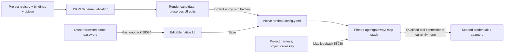

**Apply a reviewed registry change:** validate, render, explicitly apply, then
recreate **only** agentgateway using base + projects overlay and `--force-recreate`.
UI saves reload automatically; recreation is not needed for each UI edit. Keep
the `mcp-stack` namespace and never remove orphans. To disable only the UI, set
`projects/ui.json` `enabled` false and perform that same explicit sequence,
retaining password/hash, caller keys and project intent. The detailed reference
includes exact commands, persistence tests and qualification evidence.

## Current shared tool connections — 2026-10-08

**Configured and running:** agentgateway **v1.5.0**, same pinned official ARM64
digest, restored as `mcp-stack-agentgateway-1` in the **mcp-stack** OrbStack Compose
namespace. Native Mac endpoint `http://127.0.0.1:58080`. Four separate private
keys identify project-a/project-b and Codex/Claude. A/B are placeholders until
the real names/repo paths are supplied; keys authenticate project identity,
not a caller-supplied repo path. No global harness registrations were changed.

**Your editable inputs:** project `infra/stack.json` and shared
[infra/stack/connections.json](../infra/stack/connections.json).
[Gateway registry snapshot](../infra/agentgateway/projects.json) is now generated.
Slack, Linear and Figma are shared connection references for both projects;
fill common catalog `input` and `space` once. Project-specific nonempty `space` overrides
allow later separation. Anytype has separate references for each project's own
Space and docs/tasks collections. No new Anytype channel/Space has been created
without its actual project name/binding. Notion is now an optional blank connector
at your explicit request; Anytype remains the PKM and no mirror/sync was added.

**Intentionally disconnected:** all ten provider/project bindings are pending.
Blank or unqualified targets are never forwarded. Own route returns **503**;
the other project's key returns **403** even for initialization/discovery.
Missing/wrong key returns **401**. Authenticated health returns **200**. Filling
fields alone does not activate broad account access: provider OAuth/credentials,
actual tool schemas and resource restrictions must be qualified one at a time.
[Connection details and field guide](../infra/agentgateway/projects/README.md).

**Verification:** four policy tests passed. Synthetic A/B sessions completed five
allowed reads each concurrently; foreign route keys and cross-route session replay
were denied, tool/resource/prompt discovery was filtered, blocked tools never
dispatched, and the fixed-scope fixture adapter rejected foreign channel data
access. These qualify the gateway pattern, **not live service scopes**. No real
Slack/Linear/Figma/Notion/Anytype calls or model inference occurred. Test containers,
network and generated test config were removed. Evidence:
[qualification](../infra/agentgateway/projects/qualification.json).

**Runtime reconciliation:** at this turn's discovery, historical gateway/graph,
database, workflow and viewer containers were absent from the Docker inventory;
their definitions/private state were preserved. Only the requested pinned gateway
was restored. OpenCodex stayed running and ai-memory stayed stopped; protected
{{mstack:CLIENT_REPO}} stayed unchanged. Older installed/qualified status below is dated history,
not proof that those other services are running now. Old graph gateway configs and
keys remain available; graph routes were not restored automatically.

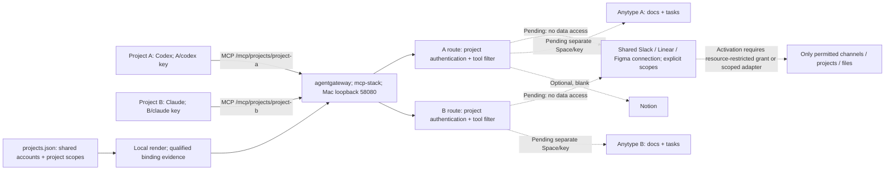

The harness sends only selected calls. Agentgateway checks project identity and
tool access; provider grants or a scoped adapter must check resource arguments
and ownership before reading/writing data. Shared accounts and shared scopes are
intentional overlap, not isolated data. Giving a client both project keys grants
that client both connections; select one project per harness session to preserve
the boundary. MCP session IDs do not replace authentication.

Model requests remain separate: Claude → OpenCodex → official DeepSeek; native
Codex keeps its existing provider. The DeepSeek API key remains behind OpenCodex.
Service OAuth/API credentials belong behind each tool connection; gateway caller
keys identify projects/harnesses. Neither a model proxy nor a tool gateway creates
external grants or automatically bridges OAuth for every provider. Windmill is
optional for reviewed jobs, not part of these interactive MCP calls.

**Continue in the same file:** fill catalog/project nonsecret fields, then run
`./stack plan --project examples/project-a` and `./stack apply --project examples/project-a`.
The low-level `./stack connections plan --project project-a` remains available. `connections render` writes local
a hash-only candidate and preserves all project routes and existing UI edits,
without OAuth or service starts. Deliberate registry activation uses `connections apply`
before targeted recreation.
Pending evidence is in [projects.bindings.json](../infra/agentgateway/projects.bindings.json).
Use base + `infra/agentgateway/projects/compose.yaml` for targeted agentgateway
operations, always Compose project `mcp-stack`; never remove orphans or run broad
`down`. Rollback stops only this service, retaining source, private keys and original
foundation/graph configurations. Future persistent tools use the same namespace.

## Current Claude Desktop connection — verified 2026-10-08

**Completed:** configured the user's downloaded **Claude Desktop 2.19675.1** at
`/Applications/Claude.app` to use **OpenCodex 2.79.0 → official DeepSeek**.
The user clarified Desktop, so no Claude Code CLI was installed. This request
reopens only the Desktop connection and `computer-use` skill update. Native
Codex provider/global configuration, OrbStack VM settings, shared stack model
routes and local-model integration remain held. Qwen weights remain pending.

**Actual UI acceptance:** Claude recognized its native gateway profile, displayed
“No Claude.ai account needed,” continued without login, and on its **Cowork**
surface answered the synthetic no-files prompt with **`MCP_STACK_DESKTOP_OK`**.
The visible selected model was **DeepSeek Flash (official)**. A private window
screenshot is under `infra/claude-desktop/state/qualification.png`; accessibility
process flags were restored to their original false values. No project files
were shared, MCP tools registered or global security permissions changed.

**Protocol acceptance:** existing `harnessbot` credential authenticated against
official `/models`; live model IDs were `deepseek-flash` and `deepseek-v4-pro`.
Selected `deepseek-flash`. Through OpenCodex, a Messages reply and streaming
termination passed. A synthetic automatic tool call `add_numbers(2, 3)` followed
by the result `5` and final answer `5` passed; cache-read usage appeared in that
follow-up. This is not a general latency, caching or task-quality benchmark.
Evidence: [qualification](../infra/claude-desktop/qualification.json).

**Known limit:** forced tool selection was rejected by upstream thinking mode;
automatic selection works. The current adapter did not disable that upstream
mode for the forced-tool probe. Code-tab file/terminal use, full Cowork file use,
project Anytype/MCP scopes and long-running jobs are **not qualified** by this
message test. The root Anytype project remains unbound. Anthropic documents its
gateway surface for Claude models; this DeepSeek route relies on OpenCodex's
adapter and the specific successful checks above.
[Desktop gateway documentation](https://claude.com/docs/third-party/claude-desktop/gateway),
[OpenCodex's Desktop guide](https://opencodex.me/guides/claude-code/).

### Message, tool and data flow

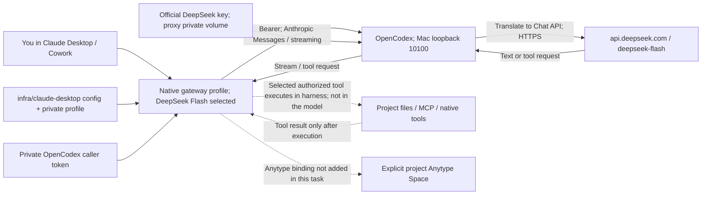

OpenCodex translates model traffic and holds the upstream key. Desktop executes
tool requests; neither model responses nor the registry automatically run tools
or enforce project isolation. Anytype MCP is a separate direct harness binding;
agentgateway and Windmill are not prerequisites for this Desktop inference route.
The synthetic tool probe executed no real filesystem/MCP operation.

**Configuration and storage:** public intent is
[infra/claude-desktop/config.json](../infra/claude-desktop/config.json).
Private profile and `_meta.json` live in ignored `state/configLibrary`, files
0600/directories 0700. The newly owned native
`~/Library/Application Support/Claude-3p/configLibrary` symlink discovers this
repo-backed state. The app's own path resolver/startup log confirmed that path.
Existing first-party app configuration is preserved; native generated caches,
logs and task history remain in Claude's ordinary `Claude-3p` directories.
Desktop contains only the proxy caller token, not the DeepSeek key. The source
key remains in ignored `.secrets/agents.csv`; its runtime copy is in
`mcp-stack_opencodex_state`. The existing OpenAI provider and proxy default were
preserved. One visible model/discovery off is a menu boundary, not per-model
authorization on the shared proxy token. No automatic fallback was added.

**Network deviation:** synthetic DNS resolved the official hostname to
`198.18.3.145`, which the proxy correctly rejected. Both Google and Cloudflare
HTTPS DNS returned public `3.173.21.63`; native TLS for `api.deepseek.com` passed
before adding an OpenCodex-only `extra_hosts` entry. Only that service was
recreated, preserving volumes and other containers. Global DNS, VM config,
private-network opt-ins and certificate stores were unchanged. The public IP
can change: this is a temporary mapping, not a permanent provider address.
See [DNS evidence/refresh](../infra/opencodex/dns-evidence.json). Ancillary native
telemetry logged region-related 403s; the tested gateway response still worked.

### Everyday operation and scoped recovery

Open **Claude** from Applications. Continue the custom-gateway welcome if shown;
no Claude.ai account is required. The gateway profile is already applied. Use
**DeepSeek Flash (official)** for this tested connection. Do not rerun installation,
provider binding or paid probes to begin a normal session.

**OpenCodex dashboard login:** at `http://localhost:10100/#dashboard`, paste the
contents of `.secrets/opencodex/admin-dashboard-token`. The original
`data-plane-token` is for Claude/model requests and is intentionally rejected
by management endpoints. Exported the existing admin token privately on October
8 (0600 file, ignored; no rotation or restart): management authentication passed
200 with admin and rejected the model token with 401. The directory spelling is
`opencodex`. Never put the admin token into Claude's model profile or chat.

If the proxy was deliberately stopped, its existing pinned service can be resumed
without rebuilding or affecting the other overlays:

```sh
macctl run docker compose -f infra/opencodex/compose.yaml up -d --no-deps --pull never opencodex
```

If connectivity fails, inspect the proxy health and refresh the public hostname
mapping using both HTTPS DNS sources and TLS validation; never enable private
destinations or modify Mac/VM DNS to silence the rejection. If a proxy restart
briefly reports an unknown alias, wait for startup catalog initialization or
refresh authenticated `/v1/models?ids=desktop` with the Anthropic version header;
do not change model names or rebind credentials speculatively.

Rollback is scoped: quit Claude and remove only the proven owned configLibrary
symlink, retaining private profile/history. Remove only the DeepSeek provider
through its management API if requested. A private before-change config backup
exists in the proxy volume; do not replace later unrelated config with it. Remove
the hostname mapping and recreate only OpenCodex if that connection is retired.
Never delete its volumes, remove orphans or run project-wide `down`.
Detailed file locations: [Desktop integration](../infra/claude-desktop/README.md).
The repo-local [computer-use skill](../.agents/skills/computer-use/SKILL.md) now
recognizes Desktop versus CLI, performs observed native UI operations, keeps
keys in the right layer and distinguishes these acceptance scopes. Skill
validation and Python/JSON source validation passed.

## Current local-model host — Llama GUI replacement, 2026-10-07

**Completed:** replaced the standalone command-line llama.cpp host with the user's
downloaded **Llama.app 0.43.0** (bundle 261002.1149), installed at
`/Applications/Llama.app`. Open Llama in Applications and use its **menu-bar icon**
for the model management panel, settings and Open chat. The DMG SHA-256 matches
the official release; arm64 bundle signature and notarized Gatekeeper checks passed.

The old `infra/llama.cpp/state/runtime/b11429` runtime and its downloaded archive
were removed. No old weights, daemon or model volumes existed. Preserve its infra
entry/docs and historical hashes; its launcher now refuses the retired runtime.
Llama GUI uses its own pinned **b11200** engine: it does not eliminate llama.cpp
as the underlying inference engine.

**Verified on the Mac:** `/health` 200, `/props` 200 with build
`b11200-81bc6b83f`, `/v1/models` 200 with an empty list, listener only on
`127.0.0.1:9931`. No weights or inference. Login autostart and automatic app updates
are disabled; agent mode and network exposure are off. UI status-bar item is
present. **Latest storage decision — move back completed:** the user explicitly
requested reversing the temporary native Mac move. Engine, model cache and
generated state again live under the repo's `infra/llama-app/state`:

- Engine: `state/engine/llama`, reached through `~/.llama-app` on the Mac.
- Model downloads: `state/models/hub` (empty; Qwen weights still pending).
- Generated state: `state/application-support`, reached through the app's native link.

Project configuration/overrides remain under `infra/llama-app`; `~/.config/llama`
still targets the repo override folder. The app's macOS preference domain stores
UI settings and a pointer to the repo-backed model folder; the secret-free setup
snapshot is recorded in `infra/llama-app/preferences.plist`.
Native app logs remain under `~/Library/Logs/Llama/`.

Restoration copied and hash-verified all three current engine/state files, restored
only owned app links and the model-directory preference, then verified native
version, loopback listener and three router endpoints. Temporary native copies
and `~/Develop/mcp-stack/local-models` were removed only after matching hashes.
Archives and every infra entry remain preserved. Only Llama was restarted;
Codex/OpenCodex/VM settings were untouched. Keep repo placement unless the user
requests another change; no automatic migration follows from generic advice.

**Performance reasoning, not a benchmark:** execution has always been native
macOS CPU/Metal. Current files are on Linux storage accessed through OrbStack's
sharing mount. Loading/memory-mapped page-fault access can depend on placement;
resident weights may make placement less relevant to generation speed. No model
benchmark exists: neither zero storage impact nor a measured slowdown is claimed.
The user chose repo placement. Data/overrides need repo access; this is not VM independence.
[OrbStack sharing docs](https://docs.orbstack.dev/machines/file-sharing),
[pinned engine mapping source](https://github.com/ggml-org/llama.cpp/blob/b11200/src/llama-mmap.cpp).

**Storage deviation:** the native installer initially failed copying its helper
into the OrbStack-backed engine folder. Prepared the same pinned official engine
artifacts via byte writes/stdin decompression. Initial terminal version probes
were killed; atomically replacing the engine while Llama was stopped resolved
them. Native version (`0.5.0-dev`, build 11200) and the GUI router checks now pass.
Never overwrite a running engine in place. This deviation belongs to the initial
VM-backed install; the restored current paths use the same placement. Retain its
workaround and qualify app-managed upgrades/model downloads before claiming they pass.
The app-created terminal symlink was removed. Full install/storage/rollback
details: [Llama GUI](../infra/llama-app/README.md).

That October 7 request reopened only local-host replacement. **Codex/local-model
OpenCodex integration remains on hold**: no Codex provider settings, OrbStack VM settings or shared
stack config-management/model routes changed. The existing pending stack route
still has its historical `llama.cpp-macos` label; it is not a ready GUI/proxy binding.

## Current hold and model decisions — 2026-10-07

The user selected **Qwen3-4B-Instruct-2507** as the first local model. This is a
model choice, not a completed weights download or inference test. Quantization,
artifact pinning, download and activation remain pending.

**DeepSeek must use the official provider, with its API key configured behind
OpenCodex.** No alternate DeepSeek provider, client-side DeepSeek key or silent
provider fallback is requested. October 8 qualifies this route for Desktop as
documented above; native Codex and other callers remain held/unqualified.

**Codex/local-model OpenCodex integration is on hold while another Codex heavy-work task runs.**
Do not proceed with Codex/provider configuration, OrbStack VM configuration,
mcp-stack skill updates or the repo's config-management flow until the user
explicitly resumes this work. The later Desktop/skill request is the narrow
exception documented above. Preserve the installed proxy and services;
this hold requests no stop/restart of Codex, OpenCodex or existing stack services.
The later GUI replacement above was separately requested and completed; no model
download or inference was performed.

The **retired** standalone llama.cpp executable had these locations; both are
now absent, and must not be used as the current model host:

- Ubuntu/shared repo: `/home/developer/workspace/mcp-stack/infra/llama.cpp/state/runtime/b11429/llama-b11429/llama-server`
- macOS/Finder: `/Users/{{mstack:MAC_USER}}/OrbStack/devbox/home/developer/workspace/mcp-stack/infra/llama.cpp/state/runtime/b11429/llama-b11429/llama-server`

Its native version/device checks passed before removal. The active GUI is now
`/Applications/Llama.app`, with an empty model router on Mac loopback 9931.

**Docker observation updated 2026-10-07:** protected {{mstack:CLIENT_REPO}} containers and
mcp-stack-ai-memory were already running when this task began; this differs from
the October 6 snapshot. They were not restarted or reconfigured by this work.
This task added only mcp-stack-opencodex (healthy). The other stack components
were not resumed. Configured service URLs below are not universal live-health claims.

Installed means a service exists. Bound means application credentials/resources
are configured. Tested means the stated operation passed. These are different
milestones. A diagram is a connection map, not proof that a workflow ran.

## Progressive stack update — 2026-10-07

The [design papers](design/README.md) now describe six scales of usage and their
message/data boundaries, small-config design, local-model alternatives/effort and
focused next improvements. They are designs; no extra example service/workflow
was deployed. [stack-use](../.agents/skills/stack-use/SKILL.md) operates the workflow
and is maintained from verified usage rather than hypothetical policy.

**Implemented:** repo-local `./stack init`, `plan`, `doctor`, `presets` and `run`.
The authored project config is now six fields in `infra/stack.json`; binding IDs
and evidence live separately in `infra/stack.bindings.json`. Shared presets/model
route definitions live in `infra/stack/`. Source/tests live in `integrations/stack/`.
Clock reuses its verified legacy registry without copying keys. Its new launcher
resolves only project Anytype and the requested native Codex model; global settings
and this desktop chat are unchanged. Root project config remains unbound and cannot
inherit Clock's key. Seven meaningful CLI tests passed; Clock doctor/launch inspection
passed. Init does no service start, remote writes or model downloads.

**Historical llama.cpp install — subsequently removed:** official b11429 (v0.6.0-linked release), arm64 macOS binary,
SHA-256 verified, native executable version passed on Apple M5 / 32 GiB. Runtime
under `infra/llama.cpp`; Metal-native host selected. The artifact/archive are now
removed; Llama GUI replaces it as documented above. The user selected
Qwen3-4B-Instruct-2507 for daily tool calls; weights and activation remain pending.

**OpenCodex installed/running:** 2.79.0 from commit beba8b7e5e479f3d8b4d404e3e47cf4aaef4d936;
built/pinned image and isolated volumes in `infra/opencodex/compose.yaml`.
Dashboard http://127.0.0.1:10100; Ubuntu provider endpoint
http://host.orb.internal:10100/v1. Health/readiness 200, missing token 401,
authenticated models-list 200. Advertised models alone are catalog metadata.
October 8: official DeepSeek binding, Messages/streaming/automatic tool round trip
and actual Desktop response passed. Local and native Codex bindings remain held.
No host Codex credentials were copied, no host shim/account pool installed, and
no global provider rewrite. Proxy-owned Codex state is isolated in its container.

**Accepted first model:** Qwen3-4B-Instruct-2507. A qualified GGUF quantization
(Q4_K_M was proposed) remains subject to artifact/template tests; the user has
not selected a specific quantized artifact. Not downloaded or benchmarked.
OpenCode is an alternative harness; LM Studio an alternative model-management/host
path. Neither is needed in addition to the selected llama.cpp + OpenCodex + Codex
CLI path, with **Llama GUI** now managing the local engine/models. See [model decision/effort paper](design/003-LOCAL-MODELS-AND-PROXY.md)
for sources, tradeoffs and estimates. After the user resumes the held integration,
select/pin weights and prove a small real tool cycle before using the local route
for Anytype edits.

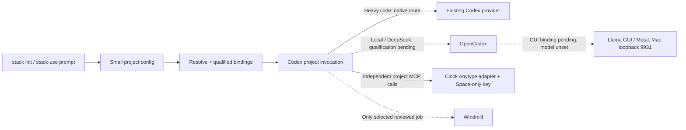

Bounded lifecycle details: [Llama GUI](../infra/llama-app/README.md),
[retired llama.cpp](../infra/llama.cpp/README.md),
[OpenCodex](../infra/opencodex/README.md). No broad Compose down/prune or orphan
removal. Existing infra definitions and durable state remain preserved.

## Everyday knowledge path — direct harness

### Project 1 — Clock, verified 2026-10-07

Clock is implemented at `examples/clock` with the **Codex + direct Anytype** preset.
The [registry](../examples/clock/infra/mcpstack.config.json) is consumed by the
[preflight](../integrations/agents/project_registry.py) and
[project Codex launcher](../examples/clock/infra/anytype/codex.py).
It records actual Space/object/collection IDs, tool purposes and disabled tools.
The launcher requests `gpt-6.1-sol` with high reasoning and enables only
`clock_anytype` among configured MCP servers for that invocation. It does not
change global settings or this existing desktop conversation's model/tool menu.

**Anytype connection completed.** Native macOS System Events created the personal
**Clock** channel and **Clock / Home** page. The existing Accessibility access was
used; no global macOS security permission was changed. A dedicated `mcp-stack / Clock`
API v2 key grants read/write to Clock only; “all spaces” is off. The key is stored
in ignored `.secrets/clock/anytype_api_key` with mode 0600, never in source or the browser.
Anytype's authenticated grant and full Space ID were read back. The root project
has no separate Anytype binding; it must not inherit this Clock credential.

Official `@anyproto/anytype-mcp@2.0.1` was installed locally under
`examples/clock/infra/anytype`, scripts disabled; pinned npm integrity verified.
Existing macOS Node 24.21.0 runs its stdio server through `macctl` so the API stays
on macOS loopback `127.0.0.1:31009`. A snapshot of the app's API v2 schema limits
MCP discovery to 18 relevant operations: no chat, deletion or Space creation.
An MCP request outside the key grant returned **403 `space_not_granted`**.
API v2 remains prerelease; requalify its schema/permissions before upgrades.

Through that direct MCP transport, this harness created/read back:

- **Clock / Docs:** project brief, plan/decisions, status, verification (4 objects).
- **Clock / Tasks:** 7 task objects; all Status values and Done checkboxes verified.
- Both collection memberships, and **Clock / Home** links to the collections.

The [checkpoint](../examples/clock/docs/STATUS.md),
[task ledger](../examples/clock/docs/TASKS.json) and
[integration evidence](../examples/clock/docs/ANYTYPE-VERIFICATION.json)
record the outcome. Anytype is canonical for these project records. Re-runs use
recorded IDs, preserve existing documents and read before updates. No background
sync/watcher exists; UI edits need the next explicit harness read. Every source
write was followed by read-back; ai-memory refresh is **pending** its separate
project client binding. No memory broadcast or graph reindexing occurred.

**Web result:** SvelteKit 3.0.1 / Svelte 5.57.2 clock with analog/digital time,
date/timezone, 12/24 toggle, saved themes, world clocks and day progress. Type
check, five clock tests, static build and seventeen browser assertions passed.
[Web evidence/screenshots](../examples/clock/docs/VERIFICATION.md).
Preview: [127.0.0.1:5173](http://127.0.0.1:5173/), verified on Ubuntu and macOS.
No deployment occurred. Existing Docker services were preserved; their inventory
above remains dated October 6.

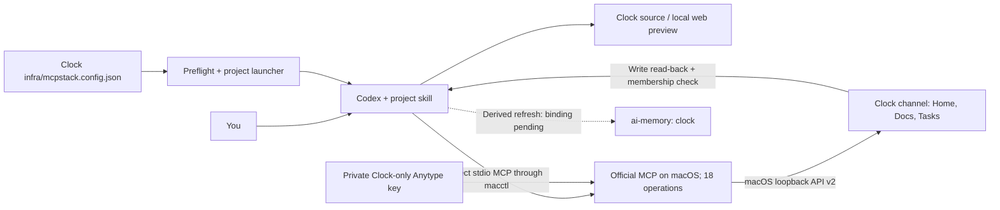

The browser receives no knowledge/model credentials. No gateway or Windmill is
required. The [repo-local computer-use skill](../.agents/skills/computer-use/SKILL.md)
now documents the actual native UI fallback as well as the project stages.

**Latest task preference, 2026-10-06:** reserve Codex for heavy coding,
debugging and code review. Daily knowledge work should use a local model through
a compatible harness. This supersedes the earlier everyday-Codex default below
as a desired work split; existing providers and runtime configuration are unchanged.

| Work | Desired tool | Status |
| --- | --- | --- |
| Daily notes, summarization, translation and bounded Anytype object edits | Small local model + Codex/OpenCodex route | llama.cpp/OpenCodex installed; weights/provider/tool qualification pending |
| Heavy coding, debugging and code review | Codex | Existing setup retained |
| Reviewed scheduled or repeatable project jobs | Optional Windmill | Existing service retained; native job acceptance pending |

The earlier candidate was **llama.cpp plus OpenCode**. OpenCode documents
[a llama.cpp provider](https://opencode.ai/docs/providers/#llamacpp) and
[direct MCP connections](https://opencode.ai/docs/mcp-servers/). It remains an
optional, uninstalled alternative; the selected path is now llama.cpp +
OpenCodex + Codex CLI above. Hardware is checked, weights remain postponed;
qualify actual tool calls before local-model Anytype writes.
No automatic paid-model fallback is proposed.

Proposed daily flow: user → local harness → llama.cpp for inference;
the harness separately calls Anytype MCP, then refreshes the one changed object's
derived ai-memory entry. A model host serves inference; the harness executes MCP
calls and follows project instructions. No gateway or Windmill prerequisite.
Clock Anytype is qualified above; other project bindings and ai-memory remain pending.

**Latest refinement, 2026-10-06:** work in Codex or DeepSeek Harness and call
Anytype MCP directly. Gateway and Windmill are not required for reading/editing
knowledge. Existing harness model configuration stays unchanged.

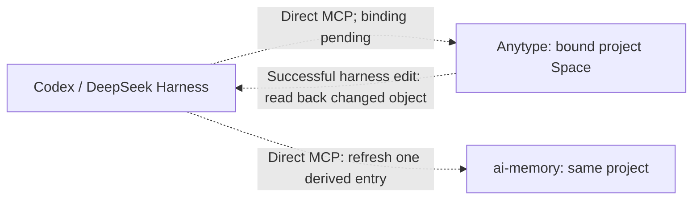

Policy: [infra/mcpstack.config.json](../infra/mcpstack.config.json).
Harness instructions: [project skill](../.agents/skills/mcpstack-policy/SKILL.md).
Anytype is canonical. After a successful authorized harness write, the harness
reads back that object and upserts a bounded project-memory entry with source
Space/object IDs, revision/hash and provenance. A failed memory refresh leaves
the successful Anytype edit intact and is reported as pending. No automatic
Basic Memory writes or Graphify/CodeGraph indexing follows.

The root remains an **instruction profile**, with no separate live project binding.
Clock has the qualified scoped connection above; new projects require their own
Space/key/transport qualification. ai-memory project/client binding remains pending.
The expected private key location is `.secrets/anytype_api_key`; do not paste it
into chat. No gateway route or workflow deployment is needed to finish this path.

App/UI edits are read and refreshed when the harness next explicitly accesses
the object. Updates while the harness is idle need a small local watcher/event
handler; none is installed. The config/skill cannot observe changes on its own.
The follow-up profile supersedes earlier no-mirroring statements **only for this
changed-object refresh**. The gateway/workflow/model-routing diagrams later in
this file describe optional expansion, not prerequisites for ordinary PKM work.

## 1. Current position

The everyday starting point is **Codex and ordinary project files**. Windmill is
the primary engine for repeatable jobs; n8n supplies optional app connectors.
WhoDB and Garage are installed. The end-to-end agent/workflow/storage integration
is incomplete; you can already use the local project example without it.
**Anytype is the sole PKM**, initially local-only on macOS. Basic Memory stays
secondary; ai-memory joins Graphify/CodeGraph as an optional contextual candidate,
with a different role: working-memory/handoff rather than source-graph analysis.

| Component | Recorded state | What remains / usage boundary |
| --- | --- | --- |
| Codex | Primary coding harness; Clock project launcher configured/qualified | Existing desktop provider/menu unchanged; no global registration |
| DeepSeek Harness 0.2.0-rc.2 | Existing profile/sessions preserved; graph MCP registration/discovery qualified on 2026-10-03 | `harnessbot` models-list authentication passed; provider patch prepared but unactivated; no inference or restart in this work |
| Windmill CE 1.823.1 | Server and worker deployed in Compose project `mcp-stack`; shared PG, separate `windmill` DB/login | Project workspace/token and S3 resource binding pending; native script/job acceptance pending |
| n8n 2.41.6 | Installed; separate application DB/login on shared PG | `mcp-stack-demo / Garage S3` credential registered and encrypted in existing personal project; native S3 workflow test pending |
| agentgateway 1.5.0 | Running in `mcp-stack`; authenticated editable owner UI; project/caller authentication qualified Oct 8; blank A/B providers fail closed | Schema validates detailed inputs; fill/qualify service scopes one at a time; no model route/global registration |
| Graphify 0.9.72 | Narrow index/config retained; container absent Oct 8 | Prior graph qualification historical; no automatic restore/new-project indexing |
| CodeGraph 1.6.1 | Config/state retained; container absent Oct 8 | Optional source structure; historical route unavailable until separately restored |
| Anytype | macOS client 0.57.4; local-only selected; Clock channel/key/direct MCP qualified Oct 7 | Clock has 4 docs and 7 tasks in verified collections; other projects/memory refresh pending; no sync server |
| ai-memory 2.5.2 | Installed container stopped Oct 8; earlier direct MCP/auth checks passed | Experimental candidate; no hooks/import, model/embedding provider or harness/gateway binding |
| Basic Memory 0.23.2 | Existing PostgreSQL/text-search service and Markdown notes retained; secondary priority | Opt-in legacy Markdown context; harness/gateway integration deferred; no Anytype mirror or semantic search |
| PostgreSQL 18.6 + pgvector 0.8.6 | Shared instance, separate service databases/logins | No business database provisioned for the example projects; no new viewer role |
| WhoDB 0.134.0 | Installed on retry; health, UI and JavaScript asset checks passed | No authenticated database connection configured/tested |
| Garage 2.3.0 | Single-node S3 installed; demo bucket and separate Windmill/n8n keys created | Client-container object exchange/isolation passed; native app acceptance and backup/restore pending |

OpenCode and OpenWiki are optional. **AppFlowy remains excluded**; Notion is now
an optional blank connection by the October 8 request. Historical source and
unrelated data remain preserved. MetaMCP is superseded; agentgateway is running
with scoped project routes. Activepieces and the
old Windmill trial were retired: their test containers,
volumes, networks and runtime credentials were removed. Their source definitions
and documentation remain. Optional tools are not deletion targets.

### Interfaces and execution domains

These browser URLs belong to the **macOS host**. Ubuntu loopback and container
loopback are separate; do not substitute one for another.
Only the restored gateway and existing OpenCodex Docker endpoints were verified
running this turn; other Docker endpoint rows are historical configuration.

| Interface | macOS address | Notes |
| --- | --- | --- |
| Windmill | [127.0.0.1:58090](http://127.0.0.1:58090/) | Existing authenticated owner/workspace needed for bindings |
| n8n | [127.0.0.1:5678](http://127.0.0.1:5678/) | Existing owner account; complementary workflows |
| WhoDB | [127.0.0.1:58091](http://127.0.0.1:58091/) | Database login still pending |
| Garage S3 | `http://127.0.0.1:53900` | API endpoint, not a browsing UI; containers use `http://mcp-stack-garage:3900` |
| PostgreSQL | `127.0.0.1:55322` | Host DB endpoint; WhoDB uses `mcp-stack-postgres-1:5432` |
| agentgateway | `http://127.0.0.1:58080` | `/mcp/projects/project-a` and `/mcp/projects/project-b`; authenticate separately, pending providers return 503; legacy graph paths not active |
| agentgateway UI | `http://127.0.0.1:58084/ui` (paste in Mac browser) | Owner login; persistent runtime editing; project registry is separate intent |
| Basic Memory | `http://127.0.0.1:58000/mcp` | MCP endpoint, not a notes editor |
| ai-memory | `http://127.0.0.1:58092/mcp` | Currently stopped; configured bearer endpoint, no web UI |
| Anytype desktop API | Normally `http://127.0.0.1:31009` | macOS local API; Clock key/direct MCP qualified Oct 7; desktop must be running |

The optional retained DeepSeek Web session was previously qualified on macOS
port 3080, using an Ubuntu loopback forwarder on 58081 for graph MCP. This is
historical session evidence, not a fresh availability/authentication check.

## 2. Work boundaries and the project config

| Work | Owner / execution location | Rule |
| --- | --- | --- |
| Open-ended reasoning, planning, tool selection | Codex; optional DeepSeek Harness | Agent proposes actions; the application authorizes and executes them |
| Authoring/reviewing code; local synthetic checks | Codex and the project's local environment | Review generated code; the current demo uses Ubuntu Python's standard library |
| Repeatable deployed scripts, retries, branches | Windmill worker, coordinated by server | Requires a verified project binding and reviewed job |
| App events and delivery | Optional n8n workflow | Add only the connector needed; no external delivery enabled here |
| Durable user/project knowledge | Anytype in the bound project Space | Direct API/MCP when relevant; no automatic mirror or broad space search |
| Working context and handoffs | ai-memory, opt-in candidate | No automatic capture/hooks; explicit scope needed before real content use |
| Existing Markdown knowledge | Basic Memory, secondary/opt-in | Retain notes; curated capture only, no automatic `infra/` import |
| Relationships/source structure | Graphify when relevant; CodeGraph opt-in | Stay inside the explicitly approved index scope |

The example policy is
[`integrations/examples/portfolio-demo/infra/mcpstack.config.json`](../integrations/examples/portfolio-demo/infra/mcpstack.config.json).
Its `AGENTS.md` points to `.agents/skills/mcpstack-policy/SKILL.md`, which directs
the harness to read the config. Compatible harnesses can discover that skill;
others require explicit loading or a qualified project adapter.

`tools.codegraph.usage: "off"` prohibits use in that project. `"opt-in"` permits
selection after an explicit request. Neither setting starts/stops containers,
changes gateway permissions or creates an index. `primary` names the default
owner, not a mandatory invocation. Project bindings remain `unprovisioned` until
actual provisioning and authorization checks pass. The JSON and skill provide
instructions, not a universal runtime loader or access-control system.

Automatic installation is disabled. A container bundle/installer is a future
idea, not part of this setup. Missing tools should be reported; use an already
allowed fallback when it satisfies the task.

The stack-level [memory-routing JSON](../infra/agents/memory-routing.json) records
the Anytype-first policy, secondary Basic Memory and optional contextual tools.
It is instruction guidance, not an active traffic dispatcher. New-project config
includes unprovisioned Anytype and ai-memory mappings; never infer ready bindings
from the stack's generic service installation.

### Anytype local-only, backup and eventual server migration

The macOS client stores the canonical PKM. Local-only disables remote backup
nodes; LAN peer sync can still occur. Backup is your responsibility. Anytype
currently marks this mode experimental. Keep exports/backups outside the sole
device; do not sync its live work directory using third-party cloud/network drives.
[Official local-only guidance](https://doc.anytype.io/anytype/data/sync-and-backup/local-only.md).

For an eventual new network identity, use native **Any-Block**, preferably
Protobuf, with linked objects, files and archived objects included. Test an import
in the destination before retiring the original. This is **not a lossless account
snapshot**: chat/discussion content is excluded and member identity references can
break. Check content, links/types/properties, attachment readability and the new
Space/object mapping. Preserve the original identity/key and a protected backup.
[Export formats and exclusions](https://doc.anytype.io/anytype/data/import-and-export.md).
The official self-host guidance recommends dedicated identities per network and
export/import for migration; no server is being installed here.
[Self-host migration guidance](https://doc.anytype.io/anytype/data/sync-and-backup/self-host).

Anytype's **local API is separate from its sync network**. Official Anytype MCP
wraps that API; it needs an Anytype bearer key, not a model-provider key. The
default desktop API is macOS loopback 31009. A future macOS MCP process can reach
it locally, but Ubuntu/Docker localhost cannot. Qualify the transport without
automatically widening the desktop API bind or installing another Anytype client.
[Official MCP implementation](https://github.com/anyproto/anytype-mcp).

Map each harness repository to an explicit Space ID. Qualify available credential
permissions and enforce scope on searches, reads and writes; global search and
object/file IDs can otherwise bypass a superficial Space-name restriction. API v2
is prerelease, so inspect the installed app/spec rather than assuming current web
examples match it. Clock Desktop 0.57.4/key/Space mapping and direct MCP writes are qualified above.
Other projects remain unbound; no Anytype content was exported.

"Direct Anytype MCP" means Anytype is the knowledge endpoint rather than copying
everything through Basic Memory. It can still sit behind a qualified gateway for
scope enforcement. No automatic Anytype ↔ Basic Memory ↔ ai-memory replication.

### Where Python runs, and what gets cleaned

Windmill's **server** serves the UI/API and coordinates queue state in PostgreSQL;
its **worker** runs jobs. Two containers are expected and let their lifecycles
and capacity be managed separately. Python submitted as a Windmill job runs in
the worker's execution environment; a shell `python3` command runs in that
shell's environment. The local example runs in Ubuntu, not Windmill.

The current worker has no host-project bind mount or Docker socket, but per-job
NSJAIL/PID isolation is disabled. It is for trusted scripts. A job can access
its worker permissions, network, credentials and persistent cache; do not assume
packages/files disappear after a job or that containerization isolates hostile
generated code. Use declared dependencies and explicit job-owned temporary/output
paths. Do not clear shared caches or volumes as routine project cleanup.

n8n's Assistant sandbox is absent. Its ordinary external Code-node task runner
is also absent, although external runner mode is configured. Built-in connector
nodes do not establish a Python sandbox. No sandbox was added by this handover.

## 3. Project namespaces and data flow

There are three distinct names in the current examples:

| Name | Meaning | Storage state |
| --- | --- | --- |
| `mcp-stack` | Docker Compose grouping for infrastructure | Existing shared services; grouping is not tenant isolation |
| `mcp-stack-demo` | Garage integration demo | Bucket `project-mcp-stack-demo-artifacts`; two separately scoped S3 keys; n8n credential registered |
| `portfolio-demo` / a copied `portfolio-research` | Local project policy/example | JSON inputs/local artifacts; remote bindings unprovisioned |
| Anytype project Space / ai-memory project | Separate knowledge/working-memory stores mapped to a repo ID | Clock Anytype qualified; ai-memory project binding pending; no cross-store sync |

Do not treat the Garage demo bucket as storage automatically provisioned for a
copied portfolio project. A copied directory does not create a Windmill workspace,
n8n tenant, database, memory project or graph index.

### Storage map

Solid edges show existing storage relationships or the recorded container S3
checks. Dashed edges show an unfinished application connection or future binding.

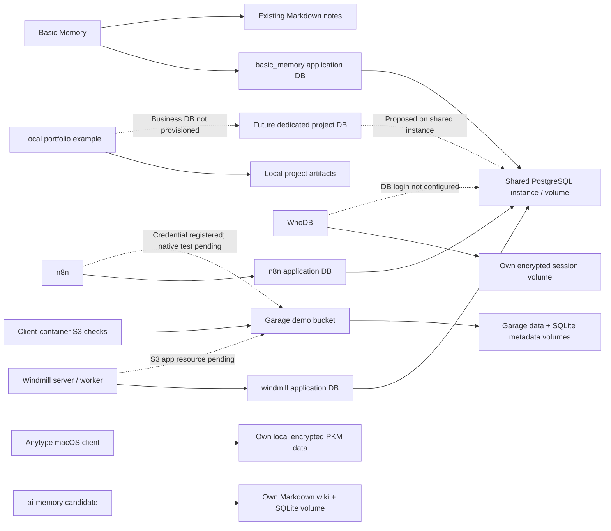

**Sharing:** tools exchange reviewed artifacts through a project bucket, or
business records through a dedicated project database. Share references such as
`project_id`, `run_id`, bucket and object key; each tool resolves its own credential.
Windmill/n8n application tables are internal state, not the cross-tool data API.
Garage has its own metadata/data storage and does not use PostgreSQL.

**Isolation:** each real project needs its own bucket and scoped per-tool keys,
dedicated business DB with narrow roles if needed, and verified workspace/memory/
graph authorization. Prefixes and matching project IDs are organizational labels.
The registered n8n credential lives in the existing personal project; its name
does not create an isolated tenant. Cross-project denial was tested for Garage
keys, not for every application's future project bindings.

**Persistence:** PG data, Garage objects, WhoDB sessions and Windmill cache/log
volumes survive individual container recreation. Persistence is not a backup.
Garage is single-node without redundancy; a full cross-service restore has not
been tested. Existing service data and `{{mstack:CLIENT_REPO}}` resources must be preserved.
ai-memory's own volume is persistent despite its experimental role; it is not
another shared-PG app. Upstream documents a single-tenant store without per-page
RBAC: workspace/project labels help retrieval scope but are not proven tenant
security. A qualified adapter or separate stores are needed before claiming
cross-project denial. No project content or automatic capture was added.
[Pinned upstream security model](https://github.com/akitaonrails/ai-memory/blob/v2.5.2/docs/security.md).

## 4. Message flow

### Overall harness, MCP, data and model flow

**Optional expansion:** the direct profile above is the everyday default. This
broader diagram preserves the proposed integrations; it is not a required chain.

This combines the **configured graph paths** and **proposed integrations**. Solid
arrows mean an existing local/file relationship or previously qualified path;
dashed arrows mean a pending connection. Runtime availability is listed in section
1: solid graph arrows do not mean the stopped containers are running today.

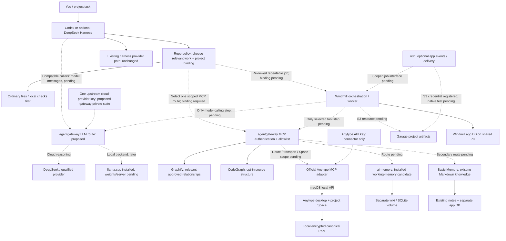

The unchanged provider box covers existing harness operation, not an alternative
key distribution implemented today. New centralized routing would replace that
path only for explicitly configured compatible callers. Codex desktop settings
are unchanged; changing a CLI provider does not automatically change the desktop.

**agentgateway:** authenticates callers and routes/filters MCP requests; a
separately qualified LLM route can authenticate model callers and inject upstream
keys. It is not the thinking agent or workflow scheduler. **Windmill:** chooses
reviewed job steps, retries and optional model calls. Interactive harness calls
need not go through Windmill. Neither component automatically interprets every
prompt or fans it out to all memory services.

### Why selective tools save context — measured and documented

There are three separate costs: tool definitions supplied to a model, selected
tool results supplied on subsequent requests, and any model/embedding calls made
inside a backend. A running MCP server or a deterministic graph/SQL/S3 query does
not inherently make a provider request. Function definitions sent to a model count
as input context; limiting tools or deferring discovery reduces that overhead.
[OpenAI function-calling token guidance](https://developers.openai.com/api/docs/guides/function-calling).

Direct ai-memory discovery on 2026-10-06 measured:

| Definition set | Tools | Serialized characters |
| --- | --- | --- |
| Entire ai-memory menu | 23 | 54,001 |
| `memory_query` alone | 1 | 7,631 |

The query-only menu is about **86% smaller in characters**. This is evidence of
avoidable schema overhead, not a measured 86% token/billing saving; tokenization,
model, caching and the harness's actual prompt assembly matter. No provider request
was made by this check. No gateway filter for ai-memory has been installed yet.

The preserved gateway template also has separate `/mcp/graphify` and
`/mcp/codegraph` routes, each with exactly one backend target and an explicit
allowlist. A request to one route does not broadcast to the other. Both menus can
still be supplied to a model if a harness loads them both, so separate routing
alone does not guarantee minimal prompt overhead. Runtime profile discovery/call
restrictions must be qualified separately. Current graph services are stopped;
this routing audit uses their config, not a new live graph/model test.

Policy: start with no retrieval if context suffices, otherwise choose one backend
for the step; add another only for a named unresolved question. Retrieve bounded
snippets/references and fetch full content when needed. A router using configuration
needs no LLM call; using an LLM to classify every request adds its own cost.

Reproduce the **offline** route/policy audit without starting any graph/model:

```sh
python3 integrations/agents/routing_audit.py
```

This checks one backend per graph route and the no-broadcast policy. It does not
claim that instructions dynamically enforce task profiles or measure provider bills.

### Available paths and their limits

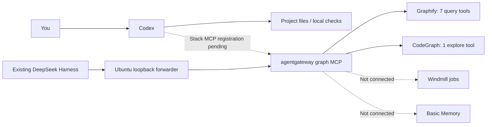

The DeepSeek arrows describe previously qualified registration/discovery, not
model/tool execution in this handover. Installing a service does not make it an
agent tool. The gateway's existing MCP paths carry tool requests/results; they
do not currently proxy model messages.

### Proposed end-to-end example — not deployed

This is the intended reviewed artifact-analysis flow after the missing bindings
are qualified. No financial account, live trade, schedule or delivery is enabled.

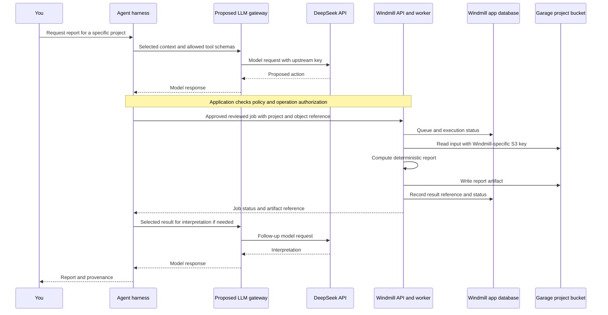

The harness-to-Windmill interface is pending: qualify either a scoped API call
or an MCP route before treating that arrow as available. Queue/status uses
Windmill's application DB; business records, if needed, use a separate project DB.
A deterministic Python job does not call a model or consume model tokens merely
because Windmill executes it.

Optional n8n extension: external event → n8n → project input in Garage → scoped
Windmill job request → status/output reference → explicitly authorized delivery.
This event/workflow connection has not been deployed or tested.

The model returns proposals; the local agent application executes allowed tools.
DeepSeek does not directly access PostgreSQL or Garage. Any context or tool result
sent to a remote model leaves the local stack, even when the original file is local.

### Credential and usage design

The proposed centralized model route keeps one upstream `harnessbot` credential
at a qualified gateway, with separate local caller identities/tokens for the
Harness, Windmill and optional n8n. **This route is not configured.** Native
DeepSeek Messages/Files, streaming, tool calls and usage reporting must be checked
against installed agentgateway 1.5.0; generic Chat Completions support alone is
insufficient evidence. Do not automatically activate the older direct-key templates.

Model keys, MCP tokens, Windmill/n8n credentials, S3 keys and PostgreSQL logins
are different credentials. Config/docs store references, never values. Existing
private key material and authenticated sessions stay in their protected locations.
WhoDB session storage is sensitive because it can retain encrypted DB credentials.

There is no centralized usage meter or vault installed. A future usage record
should carry project/run/caller IDs, credential alias, operation/model, provider
request ID, token counts, timing and status. It should exclude keys, auth headers,
raw prompts/responses, database passwords and signed URLs. A shared caller token
with an arbitrary caller-name header does not establish reliable attribution.

| Credential | Where it belongs | Status |
| --- | --- | --- |
| Existing Codex/harness provider credentials | Existing supported harness configuration | Unchanged; not automatically governed by this gateway |
| Upstream DeepSeek `harnessbot` key | OpenCodex private provider config volume | Desktop route bound/tested October 8; agentgateway LLM route remains unconfigured |
| Gateway model-caller tokens | Each compatible harness/Windmill model step/optional n8n AI credential | Proposed; these are local identities, not copied upstream keys |
| Gateway MCP caller token | Qualified project client/worker integration | Existing graph authentication retained; new project profiles pending |
| Anytype API key | Official MCP connector's protected runtime headers | Clock-only key in ignored private file; distinct from LLM and identity keys |
| ai-memory bearer | Its restricted runtime env; future adapter/client needs its own authorized access | Generated for isolated install; no client/gateway registration |
| PG/S3/app tokens | Corresponding backend resources or connectors | Separate existing service credentials; app-binding status above |

An app with an AI-assisted feature remains the **model caller** even behind a
gateway. Configure its base URL/model and local caller token to the gateway, and
the gateway resolves the upstream secret. An app that insists on a fixed provider
endpoint/direct key bypasses this arrangement and needs an adapter or an explicit
exception. Installing a gateway cannot intercept arbitrary direct API traffic or
turn all application tokens into one credential. Its present value is graph MCP
authentication/allowlisting; centralized model routing adds value for multiple
compatible callers, but is not necessary to execute a deterministic Windmill job.

### Local model host installed; weights later

llama.cpp b11429 is installed natively on macOS as recorded above; weights remain
unset and no inference server is running. OpenCodex 2.79.0 supplies the proposed
Codex protocol bridge. The local host is not a memory/MCP server. Qualification must check the chosen
build/model's tool calling, streaming, context size and the specific harness
protocol (including Codex Responses or DeepSeek native extensions as applicable).
Do not assume a generic Chat endpoint satisfies either harness completely.
[Official llama.cpp server reference](https://github.com/ggml-org/llama.cpp/blob/master/tools/server/README.md).

Proposed routing: a local model for tested small summarization/classification
tasks, cloud models for work needing their demonstrated capabilities, with an
explicit task/model choice. Failed local calls should not silently incur a paid
cloud fallback. Local inference removes provider per-token billing but still costs
compute, memory and time. Native Metal deployment is installed; model selection, provider binding and
actual inference/tool qualification remain later work. No global harness provider change.

## 5. Operating steps in this same document

### A. Resume normal work / inspect service status

Open the actual project in Codex, read its `AGENTS.md`, skill and
`infra/mcpstack.config.json`, then do the task directly. No gateway or workflow
call is required for a simple edit. Use the macOS UI addresses in section 1 for
manual inspection with your existing accounts.

From the **Ubuntu terminal**, these checks invoke the existing macOS tools and
perform no service lifecycle action or authenticated data query:

```sh
cd /home/developer/workspace/mcp-stack
macctl run docker ps -a --filter label=com.docker.compose.project=mcp-stack --format '{{.Names}} {{.Status}} {{.Ports}}'
macctl run curl --noproxy '*' --fail --silent --show-error --max-time 10 http://127.0.0.1:58090/api/version
macctl run curl --noproxy '*' --fail --silent --show-error --max-time 10 http://127.0.0.1:5678/healthz/readiness
macctl run curl --noproxy '*' --fail --silent --show-error --max-time 10 --output /dev/null --write-out '%{http_code}\n' http://127.0.0.1:58091/
```

Current expected state: pre-existing containers stopped; ai-memory healthy.
The other HTTP checks will fail while their services remain stopped. After an
independently authorized resume, expected results are Windmill version, n8n
readiness success and WhoDB HTTP 200. These checks prove availability only.
A failure is a reason to inspect that specific service, not rerun an installer.
Do not paste unreviewed logs or runtime env files into chat.

For the new candidate's bounded direct auth/discovery check:

```sh
python3 integrations/ai-memory/verify.py
```

This performs no tool execution, capture or model call; it is not a harness
registration or proof that project authorization is configured.

### B. Create and run the local mock project

Run this in Ubuntu using existing Python. It refuses an existing target and
copies only source, not secrets/state/artifacts. Change the slug before running
if `portfolio-research` already exists.

```sh
python3 - <<'PY'
from pathlib import Path
import json, re, shutil

project_id = "portfolio-research"
assert re.fullmatch(r"[a-z][a-z0-9-]{0,47}", project_id)
source = Path("/home/developer/workspace/mcp-stack/integrations/examples/portfolio-demo")
target = Path("/home/developer/workspace") / project_id
if target.exists() or target.is_symlink():
    raise SystemExit(f"Refusing to overwrite {target}")
files = ("infra/mcpstack.config.json", "AGENTS.md", ".gitignore", "README.md",
         ".agents/skills/mcpstack-policy/SKILL.md", "data/holdings.json",
         "scripts/mock_report.py", "tests/test_report.py")
for name in files:
    src, dst = source / name, target / name
    if src.is_symlink() or not src.is_file():
        raise SystemExit(f"Unexpected source: {src}")
    dst.parent.mkdir(parents=True, exist_ok=True)
    shutil.copyfile(src, dst)
path = target / "infra/mcpstack.config.json"
config = json.loads(path.read_text())
config["project"] = {"id": project_id, "artifact_root": f"artifacts/{project_id}"}
ns = config["namespace"]
ns["postgres"]["proposed_database"] = "project_" + project_id.replace("-", "_")
ns["windmill"]["proposed_workspace"] = project_id
ns["n8n"]["workflow_prefix"] = project_id + "/"
ns["memory"]["proposed_project"] = project_id
ns["graphs"]["corpus"] = project_id
ns["ai-memory"]["proposed_project"] = project_id
path.write_text(json.dumps(config, indent=2) + "\n")
print(target)
PY
```

Open the printed directory in Codex and ask it to read `AGENTS.md`,
`.agents/skills/mcpstack-policy/SKILL.md` and `infra/mcpstack.config.json`, keeping
external bindings unprovisioned. Then run, substituting your chosen slug:

```sh
cd /home/developer/workspace/portfolio-research
python3 -m unittest discover -s tests -v
python3 scripts/mock_report.py
cat artifacts/portfolio-research/report.json
```

Expected from prior qualification: seven tests pass, synthetic total `500`,
weights `0.4` and `0.6`, matching project ID, empty `external_actions`. This installs
nothing and calls no model/service. The directory is not yet a Git repository;
optionally use existing `git init` there. Publishing a remote is separate.

### C. Continue one integration at a time

| Item | Input / next bounded step | Completion evidence required |
| --- | --- | --- |
| WhoDB DB connection | Select one intended DB and privately supplied credential; prefer a scoped reader role. UI host `mcp-stack-postgres-1`, port `5432`, PostgreSQL type. No new reader role exists yet | Authenticated table inspection in intended DB; read-only grants and cross-project denial checked before claiming isolation |
| Windmill S3 binding | Already authorized; awaiting authenticated workspace ID and API token. Save token privately at `.secrets/windmill_api_token` with mode 0600, not in chat. Qualify/register resource type through supported API; use secret-variable references | Scoped resource resolves the dedicated key; synthetic native read/write succeeds; target workspace/access scope verified |
| n8n native S3 test | Credential already registered; select `mcp-stack-demo / Garage S3`, bucket `project-mcp-stack-demo-artifacts` in a reviewed inactive/manual workflow | Native S3 nodes PUT/GET the synthetic object; result checked and only the test object cleaned |
| Windmill native job | Authenticated workspace and reviewed script/input/output paths | Job succeeds with expected synthetic result and artifact reference; cleanup/persistence behavior recorded |
| Central model route | Qualify pinned gateway protocols/auth/streaming/tools/usage, then review concrete configuration | Required native Harness protocol works; separate callers authenticated; usage attributable; provider activation/inference only when authorized |
| Real project sharing/isolation | Choose a concrete project and smallest needed bindings | Authorized cross-tool exchange plus denied cross-project access; update config from unprovisioned only after checks |
| Restore readiness | Separately scoped export and isolated restore exercise | Actual restore evidence for selected DB, artifacts and necessary protected state |
| Anytype project MCP | Running macOS app/version, privately supplied API key, explicit Space ID and qualified transport/permissions | Scoped discovery/read; requested synthetic write in target Space; invalid/foreign-space requests denied; no global config |
| ai-memory project usage | Define project/workspace boundary and a small explicit query/checkpoint toolset | Scoped native usage and cross-project denial; hooks/capture remain separately opt-in |

WhoDB's encryption key is not a DB password, and a viewer does not enforce
read-only access by itself. Do not use the PostgreSQL administrator as the default
viewer connection. No credentials have been preloaded. Do not harvest owner
passwords/tokens from application tables or bypass login.

Garage uses region `garage`, path-style S3, internal endpoint
`http://mcp-stack-garage:3900`; no SSL bypass is needed for that HTTP endpoint.
Its existing keys have demo-bucket read/write access, not owner grants.
Do not re-import the already registered n8n credential as a status check.

Before any runtime change, follow the repository
[setup guard](../.agents/skills/mcp-stack-setup-guard/SKILL.md) and existing operation
authorization. This document does not grant new installation, lifecycle, model
call, database-role or registration permission. The Windmill S3 binding awaits
authentication input, not repeated approval for that same operation.

### D. Stop, clean up or recover

Routine project cleanup targets only identified generated outputs/test objects
after checking they are disposable. It never deletes shared PostgreSQL/Garage
volumes, another project's keys or retained optional tools.

Service changes must name the exact service and correct `infra/` overlay. All
overlays share Compose project `mcp-stack`: **never project-wide `down`,
`--remove-orphans`, broad prune or volume deletion**. Do not run bare Compose
inside downloaded/trial Windmill assets or rerun completed SQL provisioning.
Docker/Compose run on macOS via `macctl`; no Ubuntu Docker/mise install is needed.
`macctl` can rewrite absolute container arguments; use qualified adapters rather
than copying historical container commands blindly.

Retirement already completed does not need repeating. For an actual recovery,
use the target service's retained definition, private env and existing volume;
record exactly what was restored and tested. A healthy container alone is not
restore acceptance.

## 6. Keep this handover current

After a meaningful change, update **this file**, not a new handover filename:

1. Change the date, affected status row and pending item; name the completed check.
2. Update the matching diagram/endpoint/boundary. Promote a proposed connection
   only when its specific acceptance test passed.
3. Link the detailed record below and add a short dated change entry. Record
   missing inputs/failures honestly; do not turn installation into workflow proof.
4. Keep `infra/` definitions in place, reusable implementation in `integrations/`,
   and secrets/state out of docs. Future Basic Memory capture uses curated notes
   and source links, not a wholesale runtime-directory import.

Use PARA tags for lifecycle/purpose and Diátaxis for document kind if categorizing
future notes; this handover is an ongoing operations area combining reference,
explanation and how-to. Classification is an aid, not another required service.

### Evidence and detailed references

These preserve technical detail and history. Earlier proposed/failed states in
them do not override the reconciled status above or authorize follow-on changes.

| Subject | Source |
| --- | --- |
| Side-chat completion and continuation boundaries | [2026-10-05 handoff](SIDE-CHAT-HANDOFF-2026-10-05.md) |
| WhoDB retry and deployment | [Install record](WHODB-INSTALL-RECORD.md) |
| Garage deployment and isolation | [Install record](GARAGE-INSTALL-RECORD.md), [storage guide](GARAGE-SETUP.md) |
| n8n credential / pending Windmill resource | [S3 bindings](GARAGE-S3-BINDINGS.md) |
| Windmill deployment / retired trial | [Runtime guide](WINDMILL-RUNBOOK.md), [replacement evidence](WINDMILL-SHARED-PG-PROPOSAL.md) |
| Activepieces retirement | [Retirement record](ACTIVEPIECES-RETIREMENT.md) |
| Native graph discovery and its limits | [DeepSeek activation qualification](DEEPSEEK-LOOPBACK-MCP-ACTIVATION-PROPOSAL.md) |
| Model routing proposal | [Message/data design](MESSAGE-AND-DATA-FLOW.md) |
| Machine-readable integration status | [Inventory JSON](../infra/agents/integrations.json); guidance, not a runtime loader |
| Project policy, local example and onboarding details | [Example README](../integrations/examples/portfolio-demo/README.md), [onboarding guide](PROJECT-SETUP-RUNBOOK.md) |
| Knowledge organization | [Categorization guide](KNOWLEDGE-ORGANIZATION.md) |
| Anytype PKM/Space/local API boundaries | [Integration notes](../infra/anytype/README.md) |
| ai-memory pinned install, direct tests and rollback | [Installation record](../infra/ai-memory/README.md) |
| No-broadcast routing instruction / offline audit | [Policy JSON](../infra/agents/memory-routing.json), [audit script](../integrations/agents/routing_audit.py) |

### Change record

- **2026-10-08 (unified config):** implemented typed v3 project intent, shared
  connector catalog, derived gateway snapshot and plan/apply/adopt. Migrated root,
  Clock and blank A/B examples with source backups. Added no-op apply, per-project
  overrides, secret-rotation invalidation, owner UI drift handling and rollback.
  Clock invocation inspection remains direct; A/B/root remain appropriately unready.
  Production migration required no service restart or provider/model call.

- **2026-10-08 (owner UI correction):** user superseded our read-only choice.
  Enabled owner editing with the same private password and mounted runtime
  directory; proved save/read-back and persistence across targeted recreation,
  restored the original config, and verified enabled controls in Chromium.
  Added render-preserves-edits and explicit apply/backup behavior. User diagnosed
  Codex Command-click rewriting the native Mac address to forwarded port 62966;
  opened the correct address through macOS `open`. Unrelated services unchanged.

- **2026-10-08 (initial UI and typed configuration; read-only superseded above):** enabled authenticated read-only
  native UI on Mac loopback 58084; kept the same container pin/namespace and MCP
  caller keys. Added documented JSON Schemas, detailed project/auth inputs and
  local validation before plan/render. UI/API/write-denial and MCP checks passed;
  14 unrelated container identities/start times stayed unchanged. No provider auth.

- **2026-10-08 (scoped connectors):** restored pinned gateway in `mcp-stack`;
  added blank shared Slack/Linear/Figma/optional Notion and separate Anytype
  references, project/caller keys, route authorization and local plan/render.
  Pending production checks and simultaneous synthetic A/B checks passed;
  temporary resources removed. No live service connections or harness registration.
  Reconciled absent historical containers without recreating unrelated components.

- **2026-10-05:** Consolidated the main/side-chat status and operating guidance.
  WhoDB/Garage installed; n8n S3 credential registered; Windmill S3, native app
  tests, WhoDB DB connection and model routing remain pending. Documentation-only
  consolidation; no runtime changes or new acceptance claims.
- **2026-10-06:** Anytype chosen as sole PKM; Notion/AppFlowy integrations excluded;
  Basic Memory lowered to secondary. Installed pinned ai-memory 2.5.2 with private
  auth and no model/capture integrations; health/auth/MCP discovery passed. Measured
  full/query-only tool schema sizes. All 26 existing containers stayed stopped and
  unchanged. Added overall MCP/model/data flow and Anytype export limitations.
- **2026-10-06, direct-path refinement:** root project config and harness skill
  now prefer direct Anytype MCP with one derived-memory refresh after harness
  edits. Gateway/Windmill optional. Bindings pending; no background watcher or
  client registration was installed, and no Anytype data was accessed.

- **2026-10-07:** Created Clock channel/key through native macOS UI; qualified direct MCP 2.0.1 and project Codex launcher. Four docs/seven Done tasks and both collection memberships read back. No global registration or memory refresh.

- **2026-10-07 (progressive stack):** Added small config/CLI and stack-use skill; four design papers. Installed native llama.cpp b11429 and isolated OpenCodex 2.79.0. Weights/provider tool qualification remains pending by user choice.

- **2026-10-08:** User selected downloaded Claude Desktop, not CLI. Bound official
  DeepSeek behind OpenCodex, applied the repo-backed native gateway profile, and
  verified streaming, automatic tool round trip and a real Desktop response without
  login. Added a container-only public-host mapping for synthetic DNS; updated
  computer-use. Native Codex/local-model integration and root Anytype remain held.

Metal device discovery also passed: MTL0 Apple M5 and Accelerate are available.
This is backend detection, not a loaded-model latency/memory benchmark.
