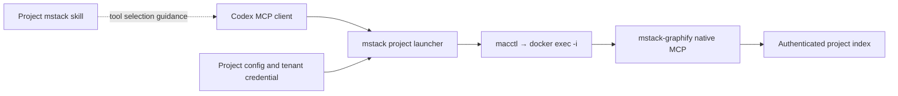

# How the harness reaches shared tools

See [the complete configuration diagrams](MSTACK-CONFIG.md) for the compact daily
intent, supporting records and all service branches. Compose namespace: `mstack`.

The project's MCP configuration selects the executable that supplies a tool.
A skill provides instructions about when/how to use it. An installed Graphify
skill does not force the harness to use a separate local Graphify installation.

An explicitly qualified project binding connects to the shared container:



Codex reads the project's `.codex/config.toml` after normal project trust, or
receives the equivalent per-invocation settings from `mstack run --project .`.
A project Graphify binding has this shape (replace the project path):

```toml
[mcp_servers.project_graphify]
command = "python3"
args = ["/home/developer/workspace/mstack/integrations/tenants/launch.py", "--project", "/path/to/my-project", "--tool", "graphify"]
enabled = true
startup_timeout_sec = 40
enabled_tools = ["query_graph", "get_node", "get_neighbors", "get_community", "god_nodes", "graph_stats", "shortest_path"]
```

1. The launcher reads the project's `.mstack/state.json `tenants` section` and private token.
2. `macctl` crosses from the Ubuntu development machine to the Mac's existing
   OrbStack Docker engine. `docker exec -i` starts one native MCP session inside
   the already-running shared container. It does not create another container.
3. A private stdin bootstrap authenticates the tenant before MCP initialization.
   The server selects that tenant's fixed index; callers cannot change it through
   tool arguments or resource paths.
4. Codex performs MCP initialization and tool discovery. It invokes the allowed
   tools using JSON-RPC over stdin/stdout and receives their results in context.

This route publishes no Graphify HTTP port and needs no agentgateway. Codex's
model provider/login is independent of this tool connection. Normal file search
remains available; the project mstack skill directs graph questions to the
qualified MCP binding and does not require using graphs for every task.

`mstack run --inspect` checks which qualified project MCP servers would be selected. It does not run a model or change the current chat's tools.
Native project trust still applies to automatic `.codex/config.toml` loading.
Claude Code has equivalent project `.mcp.json` settings and `CLAUDE.md`; a real
Claude session remains unqualified. Claude Desktop has its own connection setup.

Official reference: [Codex MCP configuration](https://learn.chatgpt.com/docs/extend/mcp).
The local implementation is in `integrations/tenants/launch.py`,
`integrations/tenants/graphify_session.py` and `integrations/stack/cli.py`.

## Which components are needed now?

**ai-memory is optional.** Use Anytype for a curated personal working note and
project decisions. Revisit a derived memory backend only when a concrete task
needs retrieval that this document workflow cannot provide. No automatic capture
or cross-project memory is enabled. Its existing state is preserved.

**agentgateway is optional.** Direct project bindings already connect this local
harness to authenticated tenants. Revisit the gateway when remote clients,
centralized routing or policy enforcement require it. A shared container does
not itself require a gateway. The optional gateway remains; retired placeholder routes and credentials are removed.

**Headroom is a useful shared helper.** Its selected MCP tools compress content,
store a recoverable original and retrieve it when needed. The shared service
keeps separate cache/statistics directories for project tenants. This is explicit
tool use; automatic interception of model traffic is a separate proxy setup.
See [shared Headroom](../infra/headroom/README.md).
