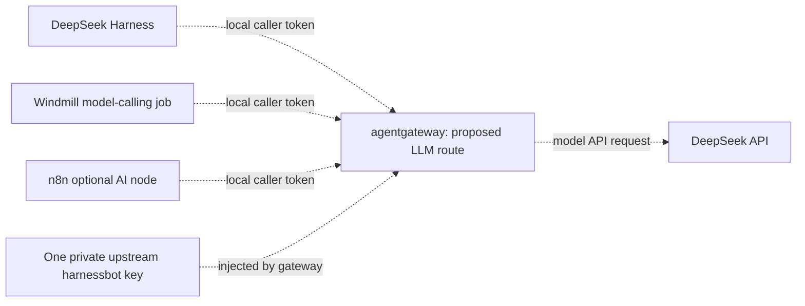
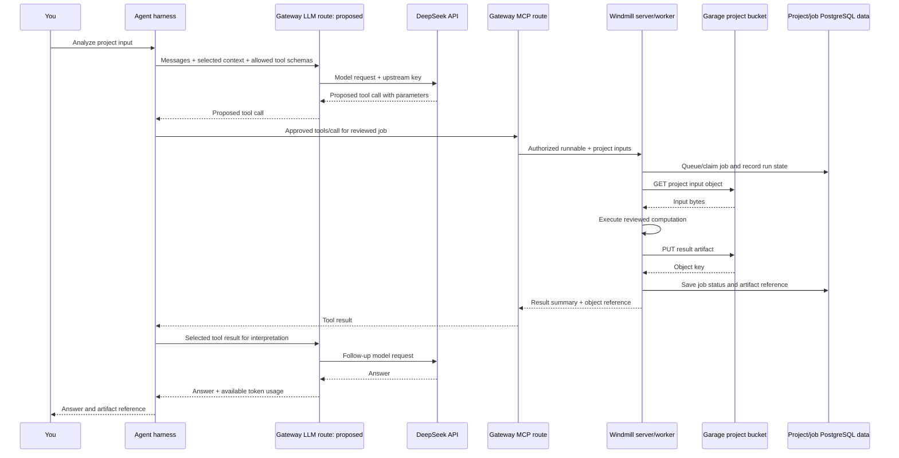
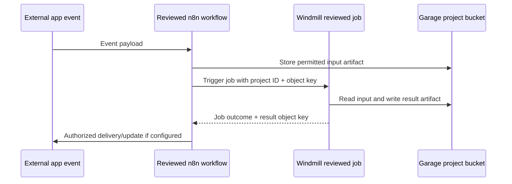

# Stack message/data flow and model credential management

**Canonical handover: [status, operating steps and flows](HANDOVER.md).** This file
retains the detailed model-routing design; proposed connections remain unimplemented.

2026-10-06: the handover now includes the overall Anytype/working-memory/MCP/model
flow and measured tool-definition overhead. Anytype replaces Notion/AppFlowy;
Basic Memory is secondary. ai-memory is installed in zero-provider mode, with
gateway/harness bindings pending. llama.cpp remains later. Older diagrams here
describe target workflows, not today's stopped-service availability.

2026-10-05. The [integration map](AGENT-INTEGRATIONS.md) describes components,
available connections and pending bindings. It is not an execution trace.
This document separates runtime request flow from credential/storage layout.

## Recommended model credential layout (proposal only)

Keep the upstream DeepSeek `harnessbot` credential at one model gateway and let
model callers authenticate to that gateway with local caller identities. Reuse
agentgateway if its pinnedv1.5.0 transport/features qualify; do not install a
second gateway or upgrade automatically. This reverses the earlier direct-key
distribution plan: do not activate copies in Windmill/n8n before deciding the
central model route. The existing prepared Harness launcher has not been activated.

The gateway becomes the place to rotate the upstream key and observe model
traffic. Caller tokens are local credentials, not additional DeepSeek account
keys. Separate caller identities are needed for dependable caller attribution;
a shared token plus an untrusted caller-name header cannot enforce separate
quotas or prove caller identity. Request/job/project IDs still need propagation.

Official agentgateway docs describe DeepSeek provider routing and backend key
injection. Those docs change; the installed binary uses a pinned configuration
schema and currently only has graph MCP routes. Provider endpoints, authentication,
streaming, tool calls, token-usage reporting and native DeepSeek Messages/Files
compatibility must be qualified against that binary before changing it. Do not
assume a Chat Completions proxy supports every native Harness API/extension.

The model route is **not installed/configured** by this S3-binding request.
No provider key has been copied into Windmill/n8n, no live Harness provider change
and no model call has occurred. A secret manager alone would centralize storage
but would not route requests or measure per-caller model usage; it is unnecessary
as an extra service for this personal setup.

An even smaller interim workflow design is to keep model calls in reviewed
Windmill jobs and have n8n trigger those jobs. Then n8n needs only Windmill
access, not a DeepSeek key. An independent interactive DeepSeek Harness still
needs its own model access, directly or through the qualified gateway.

## Model request versus tool execution

An agent application owns the reasoning/tool loop. It sends selected context and
tool schemas to the model API; the model returns text or proposed tool calls.
The application decides whether to execute them, invokes the allowed tools,
and sends selected tool results back to the model. DeepSeek does not directly
connect to Garage/PostgreSQL just because those tools are available locally.
Content placed in messages or tool results can leave the local stack; local
artifact storage does not mean that selected model context remains local.

The two gateway roles are separate request paths, even if served by one process:

- **LLM traffic:** model messages, tool-call proposals and responses.
- **MCP traffic:** executable tool requests/results, authenticated and filtered.

Gateway routing does not choose the whole workflow. Harness policy and reviewed
Windmill/n8n definitions decide which work runs and when.

## Example execution sequence (target design, not a deployed workflow)

The following example is a reviewed artifact-analysis job. The LLM gateway and
Windmill MCP binding shown here are proposed; the current graph MCP routes are
already qualified. n8n is omitted because this example needs no app event.

Jobs need not call an LLM themselves. For deterministic calculations, the worker
executes code and returns results; that does not inherently incur model tokens.
If a reviewed job needs an internal model step, it separately calls the LLM
gateway and records its own usage under the job/project IDs.

The diagram groups database operations for readability. In the real storage
layout, Windmill's application DB holds queue/job state; project business data
belongs in a separate project DB if provisioned. Existing service databases are
not shared writable application schemas. Artifact references may be object keys;
do not expose S3 credentials or signed URLs in the model prompt/log by default.

## Optional n8n event flow

This is a proposed flow, not an active external integration. n8n's S3 credential
is now registered; no workflow, trigger, outbound message or schedule was deployed
as part of that binding. Windmill resource/API binding is awaiting an authenticated
workspace token. No n8n AI step is necessary just to coordinate this event flow.

## Credential boundaries

| Credential | Stored/used by | What it permits |
| --- | --- | --- |
| DeepSeek `harnessbot` upstream key | Proposed LLM gateway only | Model-provider requests |
| Local model caller tokens | Harness, selected Windmill/n8n model clients | Only configured gateway model routes |
| MCP/workflow access tokens | Authorized harness/app clients | Allowed tools and reviewed runnables |
| Garage project/service S3 keys | Private Windmill resource, encrypted n8n credential | Scoped project buckets |
| PostgreSQL service logins | Their existing services | Their own application DBs |

LLM centralization does not merge the remaining credential families. Keep S3
keys different between Windmill/n8n so access can be revoked independently.
One bucket/key set per project is the storage boundary; workflow naming labels
inside n8n's personal project do not create separate tenants.

## Current S3 binding state

- Garage healthy and bidirectional container acceptance previously passed.
- n8n generic S3 credential **registered** in the existing personal project,
  named `mcp-stack-demo / Garage S3`, endpoint field validated against the installed
  node schema. Read/write key stored encrypted; existing credential unchanged.
- No persistent acceptance workflow added or executed; this is credential
  registration plus previously verified container reachability/S3 permissions.
- Windmill has only the built-in `admins` workspace in the inspected database.
  No workspace API token was available. An owner-provided workspace/token is
  required for the supported resource API; no default/admin login or token-table
  bypass was attempted.

## Sources

- [agentgateway DeepSeek provider routing](https://agentgateway.dev/docs/standalone/latest/integrations/llm/providers/deepseek/)
- [agentgateway backend credential injection](https://agentgateway.dev/docs/standalone/latest/documentation/configuration/security/backend-authn/key/)
- [Windmill resource API implementation](https://app.windmill.dev/pydocs/wmill/client.html)
- [n8n S3 credential fields](https://docs.n8n.io/integrations/builtin/credentials/s3/)
