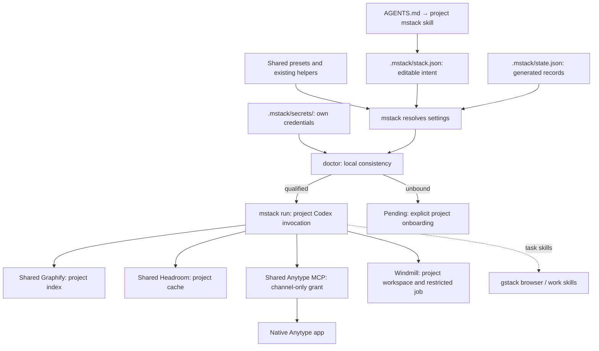

# mstack configuration

The project has **one editable configuration: `.mstack/stack.json`**. Its smallest
form is:

```json
{"project":"my-project"}
```

This selects `daily`: Codex, shared Headroom, Graphify, Anytype and Windmill,
with the existing gstack browser available. Tools are used when relevant; this
is not a required sequence. New projects receive no inherited grants.

## Everything specific to a project's mstack setup

```text
my-project/
  .mstack/
    stack.json           # editable, version-controlled intent
    state.json           # generated records; ignored
    .gitignore           # keeps state, credentials, cache and evidence private
    secrets/             # own project credentials; created when needed
    anytype/openapi.json # optional adapter schema
    evidence/            # generated verification outputs; ignored
    cache/               # temporary helper/browser state; ignored
  AGENTS.md              # harness discovery
  .agents/skills/mstack/ # harness-discovered instructions
  docs/                  # actual project documents
```

A fresh init creates `stack.json`, empty `state.json`, and `.mstack/.gitignore`.
Optional directories appear only when needed. It creates no `infra/` directory.
The discovery files stay where the harness expects them. Shared Compose files,
presets and service state belong to the infrastructure repository; consumer
projects do not copy those into their `.mstack/` folder.

`mcpstack.config.json`, the separate bindings/tenants/runtime files, and per-project
Windmill/link configuration are retired. There is no legacy reader or fallback.
Native harness files such as `.codex/config.toml` and `.mcp.json` are optional
adapters required by those harnesses, not additional mstack intent. `mstack run`
constructs Codex settings per invocation; it does not write those adapter files or
global settings. Claude sessions require their own normal project trust and qualification.



## Filled project intent

Only add fields needed by the project. This illustrates both native service
connections; placeholder IDs are not grants:

```json
{
  "project": "my-project",
  "preset": "daily",
  "tools": {"graphify": {"enabled": false}},
  "anytype": {
    "api_url": "http://127.0.0.1:31009",
    "space_id": "YOUR_OWN_CHANNEL_ID",
    "credential_file": ".mstack/secrets/anytype_api_key",
    "documents": {
      "brief": {"name": "Project brief", "local_draft": "docs/BRIEF.md"}
    }
  },
  "windmill": {
    "api_url": "http://host.orb.internal:58090/api",
    "workspace": "my-project",
    "script": "u/admin/reviewed_job",
    "credential_file": ".mstack/secrets/windmill_token",
    "mcp_credential_file": ".mstack/secrets/windmill_mcp_token"
  }
}
```

Anytype's `api_url` describes the native desktop endpoint. The shared adapter
uses its fixed Docker-to-host route and verifies the channel on every session.
Windmill's URL is used by the project bridge in its execution domain.
All top-level credential references are relative to **that project**, under
`.mstack/secrets/`. Credentials never appear in JSON or command arguments. Connection
changes, including credential rotation, require fresh qualification.

| Optional field | Default / effect |
| --- | --- |
| `version` | 3; compact v3 and existing v2 intent remain accepted |
| `preset` | `daily`; smaller presets include `solo`, `build`, `notes`, `automate` |
| `model` | Existing Codex route; selecting another route does not qualify it |
| `harnesses` | Codex for gateway manifests; direct `run` launches Codex |
| `tools` | Per-tool enable/disable, purposes and advanced connector overrides |
| `jobs` | Windmill in daily; use `tools.windmill.enabled: false` to disable the tool |
| `context` | Empty; no additional memory backend |
| `workflow` | Existing gstack browse and harness-first/container-fallback policy |
| `input` | Descriptive metadata; no filesystem permission or indexing grant |
| `anytype`, `windmill` | Explicit destination and credential references above |

See the [schema](../integrations/stack/schemas/project.schema.json) and
[expanded preset reference](../infra/stack/templates/daily.expanded.json).
Advanced named gateway connections retain shared infrastructure credentials under
the stack repository’s `.secrets/`; these are outside the consumer project and the
direct daily workflow. Existing infrastructure credentials were not relocated.

## Team repositories: local visibility and project-provided tools

Use this when a team repository already has its own conventions (for example,
Graphify or Headroom configured in its committed `.codex/config.toml` or
`.mcp.json`), and not everyone on the team uses mstack.

```json
{
  "project": "team-app",
  "visibility": "local",
  "tools": {
    "graphify": {"source": "project"},
    "headroom": {"source": "project", "server": "team-headroom"}
  }
}
```

| Field | Effect |
| --- | --- |
| `visibility: "local"` | mstack files are hidden through this clone's `.git/info/exclude`: `.mstack/`, `.agents/skills/mstack/`, `CLAUDE.local.md` and `.claude/settings.local.json`. The team's `.gitignore`, `AGENTS.md` and `.claude/settings.json` are never edited, so teammates without mstack see no change. A subdirectory project gets path-prefixed rules. |
| `tools.<name>.source: "project"` | The repository provides this tool itself. mstack requires no binding or tenant for it, adds no server of its own, and `run` keeps the project's MCP server **enabled**. Other mstack-provided tools are still linked as usual. `url`, `connection` and credential fields are rejected for it. |
| `tools.<name>.server` | Name of that project MCP server when it differs from the tool name. `run` refuses to launch if the project config doesn't define it. |

```sh
mstack init /path/to/team-app --local            # local from the start
mstack visibility --project /path/to/team-app     # report tracked/unignored leaks
mstack visibility --project . --set local         # switch an existing setup
mstack visibility --project . --set shared        # remove only the managed exclude block
```

`doctor` reports a blocker when local mstack files are already committed or not
excluded. mstack never untracks files; remove them yourself with `git rm --cached`.
In local mode, init points Claude at the skill through the personal `CLAUDE.local.md`.
Codex discovers `.agents/skills/mstack/` directly. Any capture hook goes in
`.claude/settings.local.json`, which still counts as project scope for the capture checks.

## Generated state

The one state file has six sections:

| Section | Generated contents |
| --- | --- |
| `bindings` | Qualified provider, MCP command/allowlist, evidence and connection fingerprints |
| `tenants` | Shared container, tenant identity and private token reference |
| `documents` | Anytype object IDs observed after creation/readback |
| `runtime` | Qualified implementation details, such as Windmill script/source hashes |
| `launch` | Optional generated gateway harness manifest |
| `proofs` | Source-bound receipts and evidence hashes |

Writers use locked, atomic updates so one section does not erase another.
Document writes record IDs here without editing project intent. Failed readback
retains the created ID to avoid duplicate creation on retry. Proof receipts do
not hash themselves; changes to intent, other state, source or evidence invalidate
old receipts. Records are trusted operator evidence, not live uptime guarantees.
Do not copy state or credentials between projects or delete state as disposable cache.
The old `infra/stack.json` and `infra/.mstack/` locations are no longer read; init
refuses to create competing config when an old intent file is present.

## Daily commands

```sh
/home/developer/workspace/mstack/mstack init /path/to/my-project
/home/developer/workspace/mstack/mstack plan --project /path/to/my-project
/home/developer/workspace/mstack/mstack doctor --project /path/to/my-project
/home/developer/workspace/mstack/mstack run --project /path/to/my-project --inspect
```

Init creates intent, empty state and discovery instructions. Plan/doctor are local
checks. Missing bindings remain pending until the project's own credentials and
scope tests are qualified. Direct `apply` maintains local state only; named gateway
connections retain their explicit reconciliation workflow. `run` requires ready
bindings and applies settings only to the new invocation. Existing chats do not
acquire tools automatically. `proof` checks saved evidence without replaying jobs.

The infrastructure repo keeps `{"project":"mcp-stack","preset":"solo"}`; it has
no Anytype grant. The directory and project identity remain stable. Docker Compose
uses `mstack`; old container/volume names remain compatible identifiers.

Shared service configuration remains under this repository's `infra/`; adapters
live under `integrations/`. This is infrastructure configuration, not another file
required in each project. Services are shared; stopping one affects all tenants.
See [tenant onboarding](../infra/services/README.md), [connection details](HARNESS-CONNECTIONS.md),
and [retirement record](../infra/maintenance/config-retirement/README.md).
