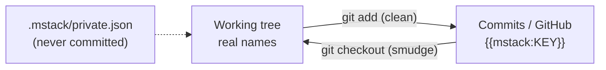

# mstack as a private GitHub repository

mstack is pushed to a **private** GitHub repo, `liyachun01/mstack`. Two kinds of information never reach it.

| Kind | Examples | How it's kept out |
|---|---|---|
| **Secrets** | Linear and Anytype keys, database passwords, service tokens | Never committed: `.secrets/`, `*/state/`, `.mstack/{secrets,evidence,journal.json,private.json}` are ignored. [`infra/secrets-inventory.json`](../infra/secrets-inventory.json) lists the files by name. |
| **Private names** | macOS account name, owner emails, client repo, brand and Linear workspace names | A git filter swaps each one for a placeholder such as `{{mstack:CLIENT_REPO}}` in every commit. The checkout keeps the real names. |

## How the placeholder filter works



- `.gitattributes` sends every file through the `mstack-private` filter
  ([`integrations/stack/private_filter.py`](../integrations/stack/private_filter.py)).
  Files that aren't UTF-8 text pass through unchanged.
- Values come from `.mstack/private.json`. Its tracked twin
  [`.mstack/private.example.json`](../.mstack/private.example.json) lists the keys with empty values.
- The filter is `required`, and `clean` fails when the values file is missing, so a commit can't silently skip it.
- A new private name: add it to `.mstack/private.json`, then re-stage the affected files (`git add --renormalize .`).
  Add the key with an empty value to the example file.

## On a new machine

1. Clone `liyachun01/mstack`.
2. Copy `.mstack/private.example.json` to `.mstack/private.json` and fill in the values.
3. Run `./mstack hydrate`. It installs the filter, rewrites the placeholders in the checkout with real names, and
   lists any secret files from the inventory that still need restoring from your backup.

## Before every push

```bash
./mstack hydrate --check
```

It searches every commit on every branch, plus the index, for each private value, and exits 2 if anything leaked.
The first push was checked this way.

## Limits

- The filter matches exact spellings. A new case variant (e.g. `Staff-Kit`) needs its own key.
- Placeholders also appear in code on GitHub, such as the protected-repo check. That code only runs correctly in
  a hydrated checkout, which is the only place it runs.
- Anytype object IDs and Linear team keys (`IRO`, `CAN`, `MST`) are not treated as private.
