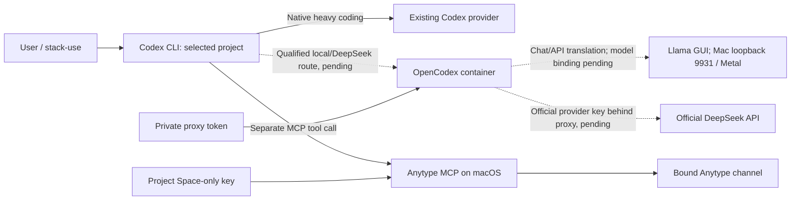

# Local models, Codex compatibility and effort

Design paper + installation record · 2026-10-07.

The selected path is **Llama GUI + OpenCodex + Codex CLI**. The user replaced the
standalone llama.cpp installation with Llama.app 0.43.0 for its minimal model
management UI. It uses a llama.cpp engine underneath. Qwen3-4B-Instruct-2507 is
accepted; weights remain absent. OpenCodex integration is on hold while another
Codex heavy-work task runs. No provider/VM/skill/shared-config changes follow
from the GUI replacement. See the current [handover](../HANDOVER.md).

## What each layer does

| Layer | Responsibility | Keys/data |
| --- | --- | --- |
| Codex | Conversation, planning, tool execution, source work | Existing native provider login remains unchanged |
| OpenCodex | Adapt Codex Responses requests to a configured provider; translate streaming/tool responses | Private proxy token; later provider credentials in isolated proxy state |
| Llama GUI | Model management and local inference using its pinned llama.cpp engine on Mac Metal | GGUF model + context/KV memory; no cloud provider key |
| Anytype MCP | Doc/object/tool API adapter | Clock-only Anytype key; independent from model keys |
| agentgateway | Optional shared MCP route/auth boundary | Only currently qualified graph routes; no new model route |
| Windmill | Reviewed job execution/retry/schedule | Project job credentials, not universal agent inference |

A model may propose a tool call; the harness runs it and sends the result back
through the model route. OpenCodex is not the Anytype dispatcher. Keys centralize
only for callers configured to use the proxy: native Codex auth stays native;
Anytype/job/database credentials belong to their respective connectors.

## Installed and verified

**Current host:** Llama.app 0.43.0 in `/Applications/Llama.app`, using pinned b11200
(live `/props`: `b11200-81bc6b83f`). DMG hash, notarized signature and router API
checks passed. Mac loopback `127.0.0.1:9931`; no installed models or inference.
The user explicitly reversed the temporary native Mac storage move. Engine,
model cache and generated state are again under `infra/llama-app/state`;
configuration/overrides also remain in the repo. Llama executes natively on Mac
while accessing VM-backed files. Restored hashes/version/router checks passed.
No performance benchmark has run. Keep this placement unless the user changes it.
App-specific preferences are recorded in the setup snapshot. See
[installation and filesystem caveat](../../infra/llama-app/README.md).
[Official Llama app](https://llama.app/),
[pinned release](https://github.com/ggml-org/Llama-macOS/releases/tag/0.43.0).

**Historical host, now removed:** hardware discovery: Apple M5, arm64, 32 GiB unified memory. llama.cpp official
**b11429** (the v0.6.0 release's linked nightly), commit
`d81235049384534c167caea52b85a694f6103d14`, installed under
`infra/llama.cpp/state/runtime/b11429`. Archive SHA-256:
`740288ec6887be94280a5dfa25b5e23a78285cab104519e6c7e218904ee82459`.
The macOS executable reports 0.6.0-dev build 11429. No global manager or Ubuntu
mise installation. No weights downloaded and no inference listener started.
Launch configuration proposes loopback port 58093, 8192 context, one parallel job,
Metal offload and Jinja tool-template parsing. Its launcher refuses an unset model.
[Official release](https://github.com/ggml-org/llama.cpp/releases/tag/b11429),
[Metal build documentation](https://github.com/ggml-org/llama.cpp/blob/v0.6.0/docs/build.md).

OpenCodex **2.79.0**, commit `beba8b7e5e479f3d8b4d404e3e47cf4aaef4d936`, built from
its pinned upstream Dockerfile/lockfiles with the digest-pinned Bun base. Runtime
image is pinned in `infra/opencodex/compose.yaml`; `install-lock.json` records it.
Container `mcp-stack-opencodex`, two separate named state volumes, Mac loopback
10100. Ubuntu reaches it at `http://host.orb.internal:10100`; verified health and
readiness return 200. Models without a token return 401; with the private token
models-list returns 200. Advertised catalog entries do not establish working
provider credentials. No provider inference, account pooling, host shim/global
Codex rewrite or desktop provider change occurred.
[OpenCodex pinned release](https://github.com/lidge-jun/opencodex/releases/tag/v2.79.0),
[upstream Compose](https://github.com/lidge-jun/opencodex/blob/v2.79.0/compose.yaml).

Proxy state lives in `mcp-stack_opencodex_state`; isolated proxy-owned Codex state
in `mcp-stack_opencodex_codex_state`. The data-plane token is privately saved in
`.secrets/opencodex/data-plane-token` and copied through stdin to the proxy's volume.
The host's Codex credentials are not mounted/copied. Container-internal rewiring
is confined to its own home. Shared Docker network membership is not project RBAC.

## Do I need OpenCode or LM Studio?

No additional harness/host is required for the selected GUI path. OpenCode is an alternative agent interface that
supports llama.cpp/DeepSeek providers directly; it could avoid the Codex protocol
adapter but adds a different harness/configuration to learn and maintain.
[OpenCode provider documentation](https://opencode.ai/docs/providers/).

LM Studio supplies model management, inference APIs and tool/MCP features, with
both GUI and headless options. It could replace the model-host experience if GUI
selection is more valuable than the small llama.cpp launch config. Its current
APIs include Responses compatibility; a direct Codex integration would still
need qualification before claiming the proxy is unnecessary. It is not needed
in addition to llama.cpp for this example.
[LM Studio APIs](https://lmstudio.ai/docs/developer).

The user chose Llama GUI instead of the standalone host; LM Studio remains an
alternative, not an additional installation. Do not run two model
hosts and two harnesses simply to cover hypothetical needs. A single-container
bundle cannot preserve native Mac Metal inference and the existing native Anytype
identity as ordinary Linux-container services; central config/launch coordination
is the useful simplification here.

## Accepted first model, not downloaded

The user accepted **Qwen3-4B-Instruct-2507**, a small non-thinking instruction model,
in a qualified GGUF quantization, initially Q4_K_M if its artifact provenance and
tool template are acceptable. The official model card documents 4B parameters,
non-thinking mode and tool usage. This is a candidate, not a claim of reliable
Codex/Anytype tool use on this Mac. Weights and actual quantization source/hash
must be selected/pinned before downloading.
[Official Qwen model card](https://huggingface.co/Qwen/Qwen3-4B-Instruct-2507).

Budget roughly 3–6 GiB for a 4B quantized model plus modest context/runtime as an
engineering estimate, not a measured figure. Memory depends on quantization,
context and batch settings. The Mac's 32 GiB also serves Docker, apps and the OS.
Prefer small context and serial use over maximum context or multiple resident
models. Do not equate the model card's long-context limit with a good local default.
Use a larger model only if the small one fails tasks worth that cost.

## Acceptance before calling the model route ready

Test plain completion, streamed completion and cancellation; then a complete tool
cycle: prompt → named tool/valid arguments → deterministic fixture result → final
answer. Include a failed tool result, no-tool request, malformed arguments and a
cross-project target. Verify that the harness/credential rejects invalid scope;
the model's willingness to obey a prompt is not authorization.
Finally run one authorized Anytype read/edit/read-back in the bound project, with
no silent cloud fallback. Keep inference/task metadata separate from secret-bearing
prompts, full transcripts and credentials. Requalify after model/template/proxy
upgrades. llama.cpp requires a supported template/parser for native tool calls.
[llama.cpp function calling](https://github.com/ggml-org/llama.cpp/blob/b11429/docs/function-calling.md).

For DeepSeek, use only the official provider, with its API key behind the isolated
OpenCodex proxy. Configuration and tool tests remain on hold. Earlier harness models-list authentication
is not OpenCodex provider qualification. Do not promise that proxy translation
makes every model an equally capable agent.

## Projected user effort

These are planning estimates, assuming existing tools remain reachable, not time
already spent or guaranteed performance.

| Stage | Your involvement | Expected total work |
| --- | --- | --- |
| Runtime installation | Already authorized; agent operated | Completed in this session |
| Choose first weights | One model/quantization decision | 5–10 minutes |
| Download/load/tool qualification | Inspect one result; agent performs checks | 30–90 minutes, download speed dependent |
| First daily Anytype exercise | Supply a real note/task | 10–20 minutes after binding/model qualification |
| New files-only project | One init prompt/command | A few minutes |
| New Anytype project | Authorize channel/binding; agent handles IDs | About 10–30 minutes if desktop/API accessible |
| First native Windmill example | Approve reviewed script/input; workspace credential needed | About 1–3 hours including failure-path checks |

Day to day, choose the preset/model once, then use the same project entry point.
Native Codex stays the heavy-code choice; local inference is the daily-cost route;
DeepSeek is deliberate secondary escalation. No automatic paid promotion.

Metal device discovery also passed: MTL0 Apple M5 and Accelerate are available.
This is backend detection, not a loaded-model latency/memory benchmark.
