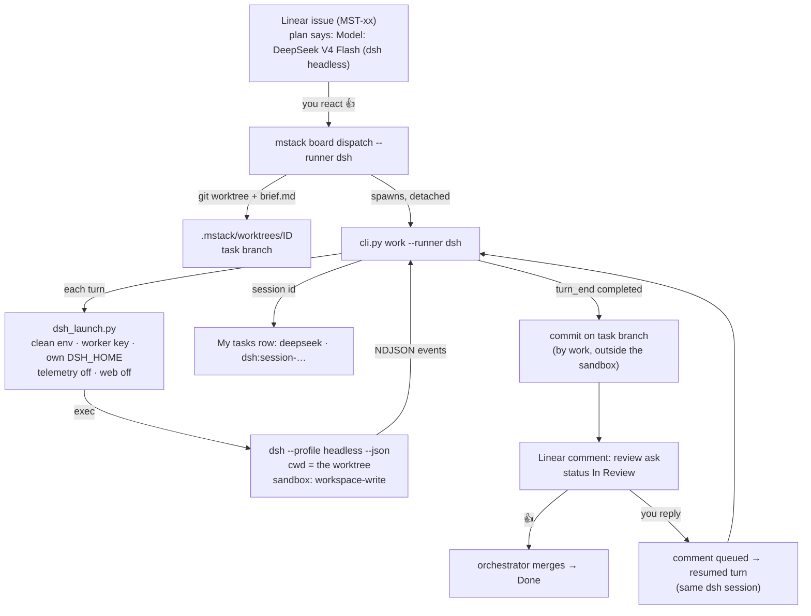

# DeepSeek worker runbook (dsh headless)

For the owner: how an mstack issue runs on DeepSeek V4 Flash through DeepSeek Harness (`dsh`), what you see at
each step, and how to stop or undo it. The design and qualification are in
[doc 015](../design/015-MULTI-HARNESS.md). Status (2026-10-31): wired and tested with a fake dsh. No real issue has
run yet. DeepSeek is the **fallback** worker; the first real run needs your 👍 on MST-62.

## The flow at a glance



What runs where:

```
 you (Linear / Claude Desktop)        mstack (unsandboxed)                     dsh (sandboxed in the worktree)
 ─────────────────────────────        ────────────────────                     ───────────────────────────────
 /plan, 👍 on the plan  ───────────▶  board dispatch
                                      └─ cli.py work ──── dsh_launch.py ─────▶ reads AGENTS.md, skills, brief
                                         │                                      edits files, runs tests
                                         │◀──────── NDJSON stream ──────────── final summary
                                         ├─ git commit (task branch)            (can't commit, can't call board)
 review comment  ◀────────────────────  └─ board done-style review ask
 👍 or reply     ───────────────────▶  merge, or `forward` → next turn ─────▶ same session, new turn
```

dsh only edits files inside the worktree. `cli.py work` does the commit and the report after each turn, because
the dsh sandbox refuses `git commit` in a worktree and `mstack board` (qualified in MST-56).

## Before the first real run (one time)

1. Merge the MST-62 branch. The board state lives in the main checkout, so `work` must run from main.
2. Add `"dsh"` to `taskboard.workers` in mstack's `.mstack/stack.json`.
3. Check the launcher **without any model call**:

```bash
python3 integrations/agents/dsh_launch.py --check
```

```json
{
  "check": "pass",
  "not_off": [],
  "patches": 1,
  "mcp_rows": [],
  "model_requests": 0
}
```

`--check` runs dsh's own `--dump-config` and fails unless session-log upload and all web tools are off.

4. See the exact command a worker turn will run:

```bash
python3 integrations/agents/dsh_launch.py --dry-run --profile headless --json "hello"
```

Output on this VM (2026-10-30; the key is never printed):

```json
{
  "argv": [
    "/home/developer/.local/share/mise/installs/node/24.19.0/bin/node",
    "/home/developer/.local/share/mise/installs/npm-deepseek-ai-dsh/0.2.0-rc.2/node_modules/@deepseek-ai/dsh/lib/bin.js",
    "--profile", "headless",
    "--patch", "/home/developer/workspace/mstack/infra/harnesses/deepseek/worker/worker.cordis.yml",
    "--json", "hello"
  ],
  "env": {
    "DEEPSEEK_API_KEY": "<redacted>",
    "DSH_HOME": "/home/developer/workspace/mstack/infra/harnesses/deepseek/state/worker-home",
    "DSH_TELEMETRY_DISABLED": "1",
    "DSH_TELEMETRY_MODE": "DISABLED",
    "HOME": "/home/developer",
    "LANG": "C.UTF-8",
    "NODE_DISABLE_COMPILE_CACHE": "1",
    "PATH": "/home/developer/.local/share/mise/installs/node/24.19.0/bin:/usr/bin:/bin"
  },
  "cwd": "/tmp",
  "model_requests": 0
}
```

Nothing else from your shell (Linear keys, other API keys) reaches dsh. The key comes from
`.secrets/deepseek-worker.key` (must be 0600). `~/.dsh` and your October web profile are never used.

## Running one issue

| Step | You do | Command (orchestrator runs it) | You see |
|---|---|---|---|
| 1. Plan | `/plan` on the issue, 👍 the plan. Its first line names the model. | `mstack board propose --project mstack --task MST-xx --plan plan.md --agent dsh` | The plan comment with `Model: DeepSeek V4 Flash (dsh headless)`; status Awaiting Approval → Todo |
| 2. Start | nothing | `./mstack board dispatch --project mstack --runner dsh` | Status In Progress; a worktree `.mstack/worktrees/<id>` |
| 3. Working | nothing (no live chat) | — (`cli.py work` runs dsh turns) | A **My tasks** row: agent `deepseek`, session `dsh:session-…`, state *active*, link `file://…/run.log` |
| 4. Review | read the comment, check the branch | — | A review comment (below); status **In Review** |
| 5a. Accept | 👍 | orchestrator merges, `board merged` | Done |
| 5b. Changes | reply on the issue | hub → `board forward` (automatic) | A new turn of the **same** dsh session; then a new review comment |

### What a dsh turn prints (fake dsh, same shape as the real one)

From the fake-dsh test harness, run through the real launcher with a synthetic key:

```text
{"type": "session", "sessionId": "session-ac627dee-ff49-4b33-94f3-046375e15c00", "cwd": ".../wt"}
{"type": "status", "phase": "turn_start", "turn": 1}
{"type": "status", "phase": "step_start", "turn": 1, "step": 1}
{"type": "tool_call", "callId": "call_1", "tool": "bash", "input": {"command": "edit dsh-turns.md"}}
{"type": "tool_result", "callId": "call_1", "status": "completed", "result": "ok"}
{"type": "status", "phase": "step_end", "turn": 1, "step": 1, "usage": {"inputTokens": 100, "outputTokens": 20, "cacheReadTokens": 900}}
{"type": "status", "phase": "turn_end", "turn": 1, "reason": {"kind": "completed"}}
{"type": "final", "text": "Fake dsh finished: Task: Fix done --doc path"}
```

How `work` reads it:

```
 session  ──▶ run.session = "dsh:session-…"         (My tasks row appears)
 step_end ──▶ usage summed into run.usage           (cost tracking)
 turn_end completed ──▶ commit + review ask         (exit code is NOT trusted: SIGTERM also exits 0)
 tool_result "requires approval" / "Permission denied" ──▶ listed as a blocker for you
 final    ──▶ the summary text in the review comment
```

The raw stream is kept beside the run log as `<log>.stream.log`, with secrets redacted.

### The comments you get on Linear

Turn completed (illustrative summary; the commit author is `mstack dsh worker`, message `dsh: <first line of the summary>`):

```text
**dsh** finished (exit 0) on branch `mst-48-…`: 1 commit(s), 2 files changed, 30 insertions(+), 4 deletions(-).

Fixed: done --doc resolves relative paths against the worker's worktree first. Test added …

Blocked (the sandbox refused these and there is no approval channel; the owner decides):
- requires approval, but no approval channel is available

React 👍 to accept, or reply with changes.
```

(The "Blocked" list appears only when dsh tried something the sandbox refused.)

Turn did not complete (no `turn_end`, e.g. a crash); the issue stays In Progress:

```text
**dsh** turn did not complete (no turn end, exit 0) on session `session-…`. Comment to resume it, or close the issue to stop it.
```

Stopped by you:

```text
Worker stopped: stopped dsh worker (pid 12345).
```

## Cost cap for the first run

DeepSeek V4 Flash only, under **US$1**. The orchestrator watches `run.usage` and runs `board stop` at 3M input
tokens (cached + uncached), 100k output tokens or 45 minutes, whichever comes first. One run, with no automatic
retry. For scale, the whole MST-56 qualification (23 requests) used 112k input and 2.6k output tokens.

## Stop

```bash
./mstack board stop --task MST-xx --reason "why"
```

This sends SIGTERM to the `work` process group after an identity check (`/proc/<pid>/cmdline`). dsh stops at once
and kills its tool child. The run is marked stopped, so queued comments are dropped and nothing resumes it. dsh
exits 0 even then, which is why mstack records the stop itself. Nothing is committed for an interrupted turn.

## Roll back

| What | How |
|---|---|
| One run's changes | Don't merge the task branch; delete the worktree and branch as for any worker. |
| Use of dsh as a worker | Remove `"dsh"` from `taskboard.workers`. Plans can't pick it any more. |
| Launcher wiring (MST-62) | `git revert` the MST-62 commits; the manifest goes back to calling `dsh` on PATH. |
| dsh worker state | `rm -rf infra/harnesses/deepseek/state/worker-home/sessions/*` (sessions only), or the whole `worker-home` (MST-56 rollback). |
| Worker key | `rm .secrets/deepseek-worker.key` (a copy; the original key is untouched). |

Never touched by any of this: `~/.dsh`, the installed dsh version, Magpie, containers and global configuration.

## Try it without DeepSeek (fake dsh)

The tests run the whole loop (dispatch → launcher → fake dsh → commit → review ask → forward → resume → stop)
without a model:

```bash
python3 -m unittest discover -s integrations/agents/tests            # launcher: env, key checks, dry-run
python3 -m unittest discover -s integrations/orchestrator/tests      # the dsh worker loop with fake_dsh.py
```

The fake (`integrations/orchestrator/tests/fake_dsh.py`) prints the event stream recorded from the real dsh in
MST-56 and acts like its sandbox: it edits files but never commits or calls `mstack board`.
