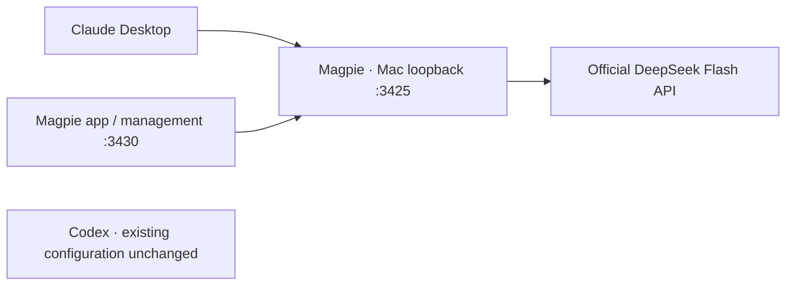

# Magpie for Claude Desktop

Updated 2026-10-21. Claude Desktop **3.1623.0** now uses the already installed
Magpie **0.1.1206** and the existing official **DeepSeek Flash** API credential.
OpenCodex was subsequently removed at the user's request, including its data and
credentials. See the [removal record](../maintenance/opencodex-retirement/README.md).
Codex integration remains **pending the user's explicit request**. Neither Mac
nor Ubuntu Codex config/auth was changed. No Claude Code CLI was installed.



## Is it easier to manage?

For this desktop workflow, yes: Magpie's provider catalog and per-agent controls
write Claude's gateway profile and model-tier mapping. The existing OpenCodex
setup required a separate container, exported client token, custom Desktop
profile and a container-specific DNS override. Magpie reached the same upstream
without that override. This is a fit judgment supported by configuration and live
checks, not a speed, model-quality or long-session reliability comparison.

| Question | Observed result |
| --- | --- |
| Can the installed version manage Claude Desktop? | Its built-in adapter applied the native profile; CLI readback confirms Magpie and DeepSeek for all four tiers. |
| Can it serve the existing model? | Three synthetic requests passed: streamed text, automatic tool request, tool-result follow-up returning `5`. |
| Is the management interface available? | Local HTTP returned 401 without its key and 200 with the key. No foreground app interaction was used. |
| Does this remove a runtime dependency? | Claude no longer requires the OpenCodex Docker container. Magpie's state remains in the OrbStack-mounted repository, so that mount must be accessible. |
| Is OpenCodex incapable of management? | No. It also has provider/dashboard controls. Magpie's advantage here is the agent-specific desktop configuration flow. |
| Are they equivalent security boundaries? | No. This Magpie route trusts local gateway callers; `magpie-claude-desktop` is a public caller marker. OpenCodex required a private data-plane token. Management has a separate private key. Both Magpie listeners are loopback-only. |

The installed binary passed macOS code-signature verification and is SHA256-pinned
in [config.json](config.json). Source review used its release tag's commit,
`8f2a314cf9779151b9caa5d60183e594239d0621`; no upgrade or reinstallation ran.
The binary was not compared byte-for-byte against a freshly downloaded release.

Primary references: [Magpie getting started](https://usemagpie.ai/docs/start),
[0.1.1206 release](https://github.com/yetone/magpie-releases/releases/tag/v0.1.1206),
[version-specific Desktop adapter](https://github.com/yetone/magpie/blob/8f2a314cf9779151b9caa5d60183e594239d0621/internal/agent/claudedesktop.go),
[OpenCodex Desktop guide](https://opencodex.me/guides/claude-code/).

## Everyday use

Open Claude normally; it reads the new profile at launch. The background Magpie
gateway is running now. Open **Magpie** from Applications to manage providers and
Claude's selection. Keep the visible model label **DeepSeek Flash (official)**:
the Claude-shaped wire alias is compatibility metadata, not an Anthropic model.
Magpie's model catalog claims do not qualify every model capability.

The managed process has **no login autostart**. After a reboot, open Magpie, or
start its background service from the Ubuntu checkout:

```sh
macctl run python3 /home/developer/workspace/mstack/integrations/models/magpie_manage.py start
```

The helper refuses occupied ports and a changed binary. To stop only the process
started by that helper, use the same command with `stop`. It checks the exact
process command before sending SIGTERM. It does not stop a different app process.
The failed launchd experiment was removed; no launch agent is installed.

Read the current agent binding without inference:

```sh
macctl run /Applications/magpie.app/Contents/MacOS/magpie claude-desktop
```

Account discovery, automatic updates, automatic provider fallback, auxiliary
vision/search/image services and request archives are disabled. Codex is hidden
from the selected agent list; this is a convenience, not an access-control rule.
Do not enable or connect it until explicitly requested. The general Magpie usage
view may also summarize existing local agent session logs; those entries do not
mean their inference is routed through Magpie. Qualification uses this gateway's
own ledger and does not rely on those unrelated session counters.

## Configuration and proof

- [config.json](config.json): public runtime pin, endpoints and migration scope.
- [qualification.json](qualification.json): fresh protocol and preservation checks.
- `state/`: ignored private provider key, settings, management key, tiers and logs.
- `cache/`: ignored Magpie cache. Native `~/.config/magpie` and `~/.cache/magpie`
  point to these repository directories.
- `.state/migration-20261021/`: historical migration settings and hash-only
  preservation evidence. OpenCodex profile/token backups were subsequently removed.
- `~/Library/Application Support/Claude-3p/configLibrary`: native generated
  adapter files. The old repository symlink was broken after relocation; the
  repaired OrbStack symlink then rejected Magpie's atomic `_meta.json` writer.
  Three profile files were copied with matching hashes to a native directory.
  The obsolete OpenCodex profile and its metadata entry were subsequently removed.
- `~/.claude/settings.json`: Magpie's Desktop adapter generated two Code-tab
  capability hints, `CLAUDE_CODE_MAX_CONTEXT_TOKENS` and
  `CLAUDE_CODE_MODEL_CAPABILITIES`. No provider endpoint or credential was added
  there, and no standalone Claude Code CLI route was configured. These catalog
  hints are not evidence that maximum context or every capability was tested.
- `integrations/models/magpie_service.py`: pinned background launcher.
- `integrations/models/magpie_manage.py`: `start`, `stop` and read-only `verify`.
  Verification checks Claude's active profile, local model catalog and management
  login without inference or Docker dependencies. The one-time migration helper
  is retired; its three paid protocol requests remain recorded in the receipt.

At migration time, all 33 existing containers retained their identities, start times, states,
settings and mounts. OpenCodex remained stopped then; the later explicit removal
is recorded separately. Mac and Ubuntu Codex config/auth
hashes matched. Other Claude Desktop settings matched, excluding the intended
deployment mode. Magpie's new broad Cowork egress and hidden-mode-chooser defaults
were removed to preserve the previous profile's policy; rerunning raw provider
wiring can reintroduce those defaults.

The actual Claude window was **not opened**: the user's background-only preference
remains in force. The configuration and Anthropic Messages protocol are verified;
native chat rendering, Code/Cowork file operations, project MCP bindings and long
sessions have not been tested through this route. No project content was sent.

## OpenCodex retirement

OpenCodex, its two volumes, image, proxy tokens and obsolete Claude profile are
removed. There is no retained OpenCodex rollback. The old applied-profile reference
was also removed from Magpie's stash so its default action cannot restore that
profile. Do not reinstall it or change Codex routing without a new request.

The native Claude library and active Magpie profile are preserved. The current
[removal receipt](../maintenance/opencodex-retirement/qualification.json) verifies
Magpie's provider/settings/key/profile, Codex config/auth and unrelated services.
